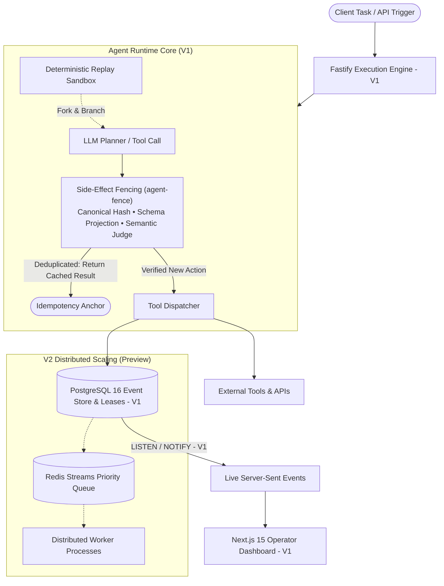

<div align="center">

# ⚡ Agent Runtime

### Deterministic Execution Engine and Side-Effect Safety Runtime for Autonomous AI Agents

[](https://github.com/Sivaguru-2008/agent-runtime/actions/workflows/ci.yml)
[](https://www.typescriptlang.org/)
[](https://nextjs.org/)
[](https://fastify.dev/)
[](https://www.docker.com/)
[](#testing--verification)
[](LICENSE)
[](https://conventionalcommits.org)

<p align="center">
  <b>A research and systems foundation for autonomous AI agents: event-sourced execution, deterministic replay sandboxing, real-time observability, and exactly-once side-effect safety.</b>
</p>

[Quick Start](#quick-start) • [Live CLI Demos](#cli-demos) • [Architecture](#architecture) • [Operator Dashboard](#dashboard) • [API & SDK](#api-endpoints) • [Project Structure](#project-structure) • [Contributing](#contributing)

---

</div>

<a id="why-agent-runtime"></a>
## 💡 Why Agent Runtime?

Deploying autonomous agents into real-world environments introduces critical reliability and safety failure modes:

1. **Duplicate External Side Effects:** When an agent encounters network timeouts, LLM retries, or process crashes, it re-plans and re-executes external actions. Because LLMs synthesize arguments non-deterministically (e.g. `Refund $100` vs `Process customer refund of 100 USD`), standard hash-based idempotency keys miss retries, resulting in duplicate billing, repeated customer emails, or corrupted database writes.
2. **Unobservable Execution Black Boxes:** When multi-step agent workflows fail midway, developers are left parsing raw unstructured text logs with no way to reproduce, isolate, or step-debug the failure.

**Agent Runtime** addresses these challenges through a principled systems architecture:
- **Event-Sourced Persistence (V1):** Every thought, tool call, memory access, and state change is cryptographically recorded in an append-only PostgreSQL event log.
- **Deterministic Replay Sandbox (V1):** Fork any failed execution at an arbitrary step into an isolated timeline to test prompt fixes or alternative tool outputs without re-running previous operations.
- **Side-Effect Fencing (`agent-fence`, V1):** Three-tier semantic deduplication protocol that guarantees at-most-once execution of irreversible external tools.
- **Live SSE Operator Dashboard (V1):** Next.js 15 web console streaming execution graphs, timelines, and replay branches via PostgreSQL `LISTEN`/`NOTIFY`.

---

<a id="cli-demos"></a>
## 🎬 Instant CLI Demos (10 Seconds)

Test the core guardrails immediately in your terminal — **no database, no servers, and zero API keys required**:

```bash
# 1. Test duplicate-charge prevention guardrail (Stripe retry simulation)
npm run demo

# 2. Test runaway-loop circuit breaker (aborts stuck agent loops at turn 3)
npm run demo:loop

# 3. Run both scenarios back-to-back
npm run demo:all
```

---

<a id="architecture"></a>
## 🏛 System Architecture (V1 Core vs. V2 Distributed Roadmap)

The codebase implements a strict boundary between the **V1 Single-Process Core** and the **V2 Distributed Scaling Extensions**:

### V1 Core Architecture (Implemented & Verified)
V1 runs as a single-process Node.js (Fastify) service backed by PostgreSQL 16. It requires **zero external cache dependencies (no Redis)** for its core execution and replay invariants:
- **Persistence:** Append-only `events`, `executions`, `execution_leases`, `tool_call_dedup`, and `replay_branches`.
- **Live Streaming:** Server-Sent Events (SSE) stream directly from PostgreSQL via `LISTEN`/`NOTIFY`.
- **Crash Recovery:** Startup scan of `execution_leases` with `expires_at < now()` recovers orphaned executions after process restarts.

### V2 Distributed Extensions (Preview / Staged Architecture)
Designed for horizontal scale when multi-node worker pools are required:
- Worker process split (`workerProcess.ts`) with distributed heartbeat leases.
- Redis Streams priority routing and dead-letter queue (DLQ) re-drive pipelines (`apps/api/src/infrastructure/queue/`).



---

<a id="dashboard"></a>
## 🖥 Operator Dashboard

The platform includes a real-time web application for execution DAG visualization, timeline inspection, and interactive replay:

<p align="center">
  
  <br>
  <em>Live Execution Timeline, Worker Fleet Status, and Event Telemetry</em>
</p>

### Platform Features:
- **Real-Time Execution Graph:** Step-by-step DAG visualization of agent cognition, tool dispatches, and memory queries.
- **Replay & Fork Inspector:** Drill down into any failed branch, inspect context state, and replay with adjusted parameters.
- **Side-Effect Safety Alerts:** Instant alerts for intercepted duplicate actions, runaway agent loops, and policy violations.
- **Multi-Tenant RBAC:** Six granular permission tiers (Owner, Admin, Operator, Auditor, Member, Viewer).

<p align="center">
  
  <br>
  <em>Interactive Failure Diagnosis & Branching Replay Experience</em>
</p>

---

<a id="core-capabilities"></a>
## 🚀 Core Capabilities

### 1. Persistent Event-Sourced Agent Runtime
- Immutable event stream backing every agent lifecycle transition.
- Transactional outbox pattern guaranteeing zero lost events during worker or database restarts.
- Full context provenance tracking for every LLM prompt, response token, and memory read.

### 2. Side-Effect Fencing (`agent-fence`)
- Built-in protection for irreversible tools (Stripe refunds, database mutations, Slack messages, email dispatches).
- Multi-tier verification:
  - **Tier 1 (Canonical Hash):** Zero-latency deterministic deduplication for exact parameter matches.
  - **Tier 2 (Schema Projection):** Typed scalar boundary checks that guarantee distinct parameter safety.
  - **Tier 3 (Semantic Judge):** Calibrated judging that catches non-deterministic LLM paraphrases without false positives.
- Eliminates runaway recursion loops and double-execution disasters.

### 3. Replayable Failures & Sandboxed Timelines
- Fork any failed execution from any intermediate checkpoint.
- Safely test prompt improvements or tool modifications in an isolated sandbox.
- Compare divergence between original runs and replay branches side-by-side.

### 4. Distributed Coordination & Resilience
- Worker lease heartbeats with automatic crash recovery and lease-loss eviction.
- Priority event queues powered by Redis Streams.
- Dead-letter queue (DLQ) triage with one-click re-drive capabilities.

---

<a id="quick-start"></a>
## ⚡ Quick Start

### Prerequisites
- **Node.js** >= 20.11 ([Download](https://nodejs.org))
- **Docker & Docker Desktop** ([Download](https://www.docker.com/products/docker-desktop))
- *(Optional)* Free **Groq API Key** for live LLM execution ([Get Key](https://console.groq.com/keys)).

### 1. Clone & Install
```bash
git clone https://github.com/Sivaguru-2008/agent-runtime.git
cd agent-runtime

# Install dependencies across all workspaces
npm install
```

### 2. Start Infrastructure
```bash
# Start PostgreSQL (port 5432) and Redis (port 6379)
docker compose up -d
```

### 3. Configure API & Web
```bash
# Configure the API backend
cp apps/api/.env.example apps/api/.env

# Configure the Web dashboard
cp apps/web/.env.example apps/web/.env

# Generate a secure operator API key
node apps/api/scripts/seed-operator-key.mjs
# Paste the output key into apps/web/.env as RUNTIME_API_KEY
```

> **Offline / Local Mode:** Set `MODEL_PROVIDER=deterministic` in `apps/api/.env` to run the complete platform locally without any external LLM API key!

### 4. Run Development Stack
```bash
npm run dev
```

- **Backend API:** `http://localhost:4000`
- **Operator Dashboard:** `http://localhost:3000`
- **Swagger API Docs:** `http://localhost:4000/docs`

---

<a id="api-endpoints"></a>
## 📡 API Endpoints

| Method | Endpoint | Description | Role Required |
|:---|:---|:---|:---|
| `POST` | `/agents` | Register a new autonomous agent | Operator |
| `GET` | `/agents` | List active agents with runtime status & lease state | Viewer |
| `POST` | `/agents/:id/tasks` | Dispatch an execution task with distributed tracing | Operator |
| `GET` | `/executions/:id` | Get execution timeline, tool invocations, and DAG | Viewer |
| `POST` | `/executions/:id/replay` | Fork a failed execution into a sandboxed replay branch | Admin |
| `GET` | `/events/stream` | Real-time Server-Sent Events (SSE) telemetry feed | Viewer |
| `POST` | `/fence/evaluate` | Standalone side-effect fence evaluation | Operator |

---

<a id="typescript-sdk"></a>
## 📦 TypeScript SDK Usage

The platform includes a lightweight, type-safe client SDK (`@agent-platform/sdk`):

```typescript
import { AgentRuntimeClient } from "@agent-platform/sdk";

const client = new AgentRuntimeClient({
  baseUrl: "http://localhost:4000",
  apiKey: process.env.RUNTIME_API_KEY,
});

// 1. Create an agent
const agent = await client.createAgent({
  name: "support-escalation-agent",
  systemPrompt: "You triage and process customer refund tickets safely.",
});

// 2. Dispatch a traced task with side-effect fencing
const execution = await client.startTask(agent.id, {
  prompt: "Process refund of $49 for customer cust_82918",
  idempotencyKey: "ticket-ref-9182",
});

// 3. Subscribe to real-time execution events
const unsubscribe = client.subscribeToExecution(execution.id, (event) => {
  console.log(`[${event.type}]`, event.payload);
});
```

---

<a id="testing--verification"></a>
## 🧪 Testing & Verification

The codebase includes comprehensive unit, integration, and chaos test suites:

```bash
# Run type checks across all workspaces (API, Web, SDK)
npm run typecheck

# Run unit and integration tests (984+ passing tests across API & SDK)
npm test

# Run formal correctness and fence-protocol invariants
npm run ci:invariants -w apps/api

# Run reliability and graceful degradation suites
npm run ci:reliability -w apps/api
```

---

<a id="project-structure"></a>
## 📂 Project Structure

```
agent-runtime/
├── apps/
│   ├── api/                   # Fastify backend: event bus, execution engine, replay sandbox, RBAC
│   └── web/                   # Next.js 14 operator platform: live SSE DAG, timeline, replay UI
├── packages/
│   └── sdk/                   # TypeScript SDK client for embedding and orchestrating the runtime
├── agent-fence/               # Exactly-once side-effect fencing protocol (published npm package)
├── agent-runtime/             # CLI harness and worker execution spine
├── docs/                      # Architectural specs, deployment guides, and ops runbooks
│   ├── architecture.md        # V1 System architecture design
│   ├── deploy.md              # Production deployment runbooks (Docker, Fly.io, Render)
│   ├── STARTUP_GUIDE.md       # Platform bootstrap manual
│   ├── specs/                 # Formal specifications (fencing, replay, retry, recovery)
│   ├── ops/                   # Week-1 runbook and on-call operational manuals
│   └── screenshots/           # Platform visual assets
├── scripts/                   # Developer tooling, database seeding, and build guards
├── docker-compose.yml         # Container definitions for PostgreSQL and Redis
├── LICENSE                    # MIT License
├── CHANGELOG.md               # Version release history
├── CONTRIBUTING.md            # Developer setup and contribution guidelines
├── CODE_OF_CONDUCT.md         # Community standards
├── SECURITY.md                # Vulnerability reporting and disclosure policy
└── README.md                  # This document
```

---

<a id="contributing"></a>
## 🤝 Contributing & Governance

We welcome contributions from the community! Please check our community guidelines before opening an issue or PR:

- **[Contributing Guide](./CONTRIBUTING.md):** Setup instructions, conventional commit formats, and PR workflow.
- **[Code of Conduct](./CODE_OF_CONDUCT.md):** Contributor Covenant v2.1.
- **[Security Policy](./SECURITY.md):** Responsible disclosure procedures and response SLAs.
- **[Changelog](./CHANGELOG.md):** Detailed history of releases and new capabilities.

---

## 📄 License

This project is licensed under the [MIT License](./LICENSE) — open for personal, academic, and commercial use.
