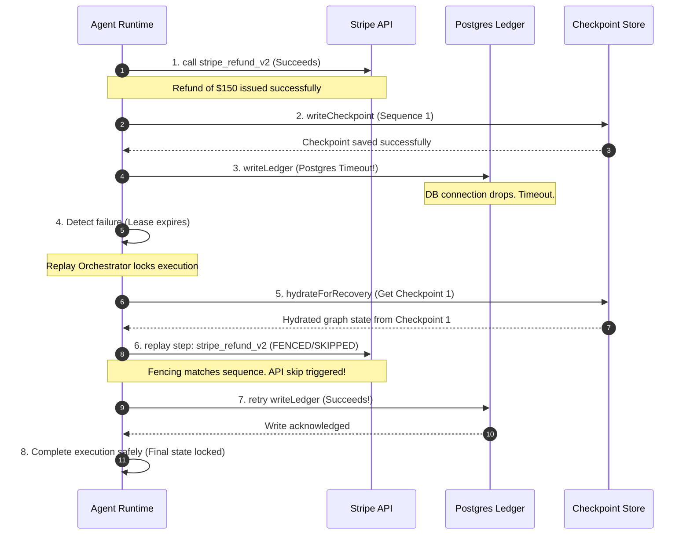

# AI Agent Reliability Runtime: Productization & Cinematic Demo Blueprint

This master blueprint transforms our transaction-isolated, event-sourced, and lease-fenced agent execution engine (Phase V3) into a world-class, investor-ready, and developer-obsessed enterprise platform. 

Written from the collective perspective of a **Stripe/Linear product leader**, a **Datadog observability architect**, and a **YC infrastructure partner**, this document translates dense distributed-systems invariants into an emotionally resonance-rich, visually stunning, and commercially fundable developer experience.

---

## 1. Timeline UX Redesign: "Git History + Incident Replay + Workflow Debugger"

Autonomous AI workflows are non-linear, stochastic, and stateful. Naive timelines fail because they present events chronologically without causal context. We redesign the execution timeline into an interactive **State-Branching Ledger** that represents time as both a sequential flow and a tree of recovery branches.

### A. Color Token System (Modern Zinc-Base Palette)

We avoid generic neon/cyberpunk aesthetics. The UI uses high-contrast, mathematically harmonious HSL colors sitting on a deep, obsidian-like zinc backdrop.

| Token Name | Hex Code / Tailwind | HSL Value | Semantic Meaning | Interface Application |
| :--- | :--- | :--- | :--- | :--- |
| **Obsidian Base** | `zinc-950` | `240 5.9% 2.9%` | Core dark canvas | Outer workspace wrapper |
| **Panel Surface** | `zinc-900` | `240 5.9% 4.9%` | Primary container | Timeline cards, inspector shell |
| **Border Muted** | `zinc-800` | `240 4.9% 8.4%` | High-fidelity gridlines | Grid divisions, idle connectors |
| **Text Primary** | `zinc-100` | `240 5% 96%` | Authoritative readout | Tool names, code outputs |
| **Nominal Green** | `emerald-400` | `142 70.6% 45.3%` | Safe, committed state | Successful tool calls, completed runs |
| **Warning Amber** | `amber-400` | `37.9 92.1% 50.2%` | Degraded, retrying | Transient error, self-healing retry |
| **Incident Rose** | `rose-400` | `346.8 77.2% 49.8%` | Uncaught failure, halt | Poison pill, hard-fencing abort |
| **Recovery Indigo**| `indigo-400` | `238.9 70% 50.4%` | Immutable checkpoint | Snapshot boundaries, state captures |
| **Replay Blue** | `blue-400` | `217.2 91.2% 59.8%` | Divergent speculative path | Replay branches, live-scrubbed frames |

---

### B. ASCII Wireframe: The Interactive State-Branching Timeline

```text
┌────────────────────────────────────────────────────────────────────────────────────────────────────────┐
│  REPLAY TIMELINE  [► Play] [|| Pause] [⏮ Seek To Start]                         Current Frame: 04 / 07 │
├────────────────────────────────────────────────────────────────────────────────────────────────────────┤
│                                                                                                        │
│  [Branch 01 (Failed)]                                                                                  │
│   (●)───────[■ Checkpoint 01]───────(●)───────(⚡) [Ledger_Write_Failed]                                │
│    01:Refund_Succeeds  02:State_Saved   03:Ledger_Pending   04:Postgres_Timeout (Abort)                  │
│                                       │                                                                │
│                                       │  [Automatic Recovery Triggered — Reclaiming Lease]             │
│                                       └──────┐                                                         │
│                                              ▼                                                         │
│  [Branch 02 (Active Replay)]             [■ Checkpoint 01 Restored]                                    │
│                                              └───────(🔒 Fenced-Safe)─────────(●)───────────────(✓)    │
│                                                       05:Refund_Bypassed       06:Ledger_Succeeds  07:Done │
│                                                      [No Double Charge]                                │
│                                                                                                        │
├────────────────────────────────────────────────────────────────────────────────────────────────────────┤
│  ▼ HOVER INSPECTION: Frame 05 (Refund Bypassed)                                                        │
├────────────────────────────────────────────────────────────────────────────────────────────────────────┤
│  Type: Idempotent Tool Execution (Skip)  │ Context: Checkpoint verified execution sequence.            │
│  Target: stripe_refund_v2                │ Action: Suppressed external API trigger to prevent double   │
│  Audit Hash: 8f9a2e... [Verified]        │         disbursement. Fencing token: 0x8a9b (Active).       │
└────────────────────────────────────────────────────────────────────────────────────────────────────────┘
```

---

### C. Advanced Micro-Animations & Live Event Streaming

1. **The Pulse-In (Event Stream)**: When a new tool starts execution, its node has a ring gradient (`blue-500/20`) expanding outward at a `1.8s` ease-in-out infinity loop, giving a tangible "working" sensation without distracting clutter.
2. **The Branch-Drop (Recovery Transition)**: When the system switches from a failed branch to a replay branch, the failed track drops its opacity to `40%`, and a vertical dotted connector morphs downward using a CSS `stroke-dashoffset` animation at `400ms` to draw the recovery bridge.
3. **The Lock-Clamp (Fencing Indicator)**: When the replay logic skips the already-executed `payment_refund` node, a visual security lock icon (`ShieldCheck`) clamps down on the node with a `0.2s` scale-up spring animation (`damping: 12`, `stiffness: 150`), symbolizing hard protection.
4. **Scrubber Glow**: Dragging the timeline scrubber displays a vertical translucent blue scanner line across the nodes, with adjacent node cards reacting by subtly shifting their Y-offset by `-2px` on enter to offer high-fidelity tactile feedback.

---

### D. Hover Inspection Panel & Execution Diff Views

When a developer hovers over any execution node, a contextual HUD panels out within `100ms` (using `will-change: transform` to prevent layout reflows), revealing:
* **The State Diff**: A line-by-line JSON comparison highlighting what variables in the agent’s episodic memory changed in this specific frame.
* **Causation Lineage**: A subtle glowing trace line connecting the current step to the exact model output (`MODEL_COMPLETED` event) that planned it, visually showing "Why this node ran."

---

## 2. Human-Readable Event System: The Developer Translation Engine

Raw technical engine events look like dry database schemas. If a developer or YC investor sees `EXECUTION_STEP_STARTED (Task 8a91)`, they feel nothing. We must translate the system-level lifecycle into developer-friendly narrative language that communicates high intelligence and precise reliability.

```typescript
// Core implementation design pattern in apps/web/lib/event-translation.ts
export interface TranslatedEvent {
  title: string;
  subtitle: string;
  icon: string; // Lucide icon identifier
  stateColor: "nominal" | "warning" | "incident" | "recovery" | "replay";
  reasoning: string; // Why this translation builds emotional trust
}
```

Here is our comprehensive, production-ready, 15-event developer translation matrix:

| Raw System Event | Improved Human-Readable Wording | Emotional/Operational Value | Visual Icon & State |
| :--- | :--- | :--- | :--- |
| `AGENT_CREATED` | **"Agent identity and safety policy compiled"** | Proves the agent is bound by strict system-level constraints before execution. | `UserCheck` / Nominal Green |
| `AGENT_STARTED` | **"Reliability runtime online & listening"** | Reassures the developer that the system is ready to orchestrate workflows safely. | `Play` / Nominal Green |
| `TASK_SCHEDULED` | **"Goal queued for active execution"** | Shows intent and scheduling capability; creates anticipation. | `Calendar` / Muted Text |
| `EXECUTION_STARTED` | **"Workflow isolation sandbox initialized"** | Establishes that the agent has a clean, protected workspace. | `Box` / Replay Blue |
| `EXECUTION_STEP_STARTED` | **"Executing step: [Step Name]"** | Gives granular, real-time insight into the active task. | `Activity` / Replay Blue |
| `TOOL_CALLED` | **"Calling external API: [API Name]"** | Flags a high-risk operation that interacts with the outside world. | `Cpu` / Replay Blue |
| `TOOL_EXECUTION_STARTED`| **"Refund API request dispatched to Stripe"** | Translates a generic tool execution into a real financial operation. | `CreditCard` / Replay Blue |
| `CHECKPOINT_WRITTEN` | **"Saved secure recovery point to ledger"** | Builds trust by proving the runtime is saving progress continuously. | `Save` / Recovery Indigo |
| `MODEL_COMPLETED` | **"LLM response parsed & state updated"** | Shows cognitive progression and decision-making clarity. | `Brain` / Nominal Green |
| `EXECUTION_FAILED` | **"Database connection timeout detected"** | Pinpoints the exact infrastructure fault without placing blame on the LLM. | `AlertOctagon` / Incident Rose |
| `RETRY_TRIGGERED` | **"Initiating automatic, lease-safe retry"** | Signals that the system is self-healing, not crashing. | `RotateCw` / Warning Amber |
| `CHECKPOINT_RESTORED` | **"Hydrating graph state from Checkpoint #[N]"** | The "aha" moment: shows the system rewinding to the last known safe state. | `Database` / Recovery Indigo |
| `EXECUTION_FENCING_REJECTED`| **"Stale execution aborted: Fencing lock held"** | Demonstrates the core defense mechanism blocking duplicate, overlapping runs. | `ShieldAlert` / Incident Rose |
| `EXECUTION_REPLAYED` | **"Retrying step [N]: Suppressing duplicates"** | Shows active replay in progress while explicitly protecting side-effects. | `GitFork` / Replay Blue |
| `EXECUTION_COMPLETED` | **"Workflow resolved successfully. State locked."** | Perfect closure. Confirms everything completed without data loss or corruption. | `CheckCircle` / Nominal Green |

---

## 3. Cinematic Failure & Recovery Flow: The Core Demo Script

To win over investors and hard-to-please backend developers, the demo flow must tell a story of **resilience under pressure**. We map the exact sequence of a transient failure and recovery, outlining on-screen changes, timing, transition logic, and "aha" moments.

### The Scene: The "Double-Refund Protection" Scenario
An agent is tasked with issuing a customer refund via Stripe and then logging it to an internal SQL ledger. The ledger database experiences a sudden lockup, triggering a failure mid-transaction.



### Second-by-Second Cinematic Storyboard

#### 0:00 - 0:15 | The Normal Ascent (Nominal)
* **Screen State**: A clean, two-column layout. The left column streams the agent’s inner thoughts in a muted monospace terminal; the right column displays a horizontal chain of nodes.
* **On-Screen Action**: Click `Run Agent Task`. Node 1 (`Agent Sandbox Init`) lights up with a subtle emerald glow. Node 2 (`payment_refund`) lights up.
* **Transition & Motion**: An emerald connector line slowly draws itself from Node 1 to Node 2 like liquid filling a tube. A quiet status indicator read-out: `stripe_refund_v2 called: $150.00 returned.`
* **Trust Beat**: A small blue icon flashes on the timeline: `CHECKPOINT_WRITTEN: Sequence 1 locked.`

#### 0:15 - 0:25 | The Sudden Drop (Transient Failure)
* **Screen State**: The connector line approaches Node 3 (`ledger_write`). Node 3 lights up warning yellow, then suddenly transitions to flashing rose-red.
* **On-Screen Action**: The left console dumps a stack trace: `PostgresConnectionTimeoutError: Pool exhausted at 10.0.0.4`. 
* **Transition & Motion**: The entire workspace background flashes a soft, dark red vignette (`duration: 150ms`, opacity `15%`). The active timeline line stops dead at Node 3.
* **Investor Sensation**: *Anxiety*. The system appears to have failed. Did we double refund the customer? Is our system database corrupted?

#### 0:25 - 0:35 | The Safe Handoff (Detection & Reclaim)
* **Screen State**: The failed Node 3 dims. A prominent center-stage badge pops up: `Lease expired (Worker 0x3a). Reclaiming ownership...`
* **On-Screen Action**: The screen splits horizontally. A new branch track, `Branch 2 (Replay)`, fades in at `50%` opacity directly below the first track.
* **Transition & Motion**: A vertical indigo dashed line descends from Node 2 (`payment_refund`) in Branch 1 down to the start of Branch 2. Node 2 in the replay track lights up with a dark-blue boundary.
* **The "Aha" Visual Moment**: An animated **steel fencing gate** graphic or a secure lock overlay clamps over the replayed Node 2 with the label `REPLAY_DEDUPLICATED (FENCED)`.
* **Narration Cue**: *"Look closely at Node 2 in the replay. Because the runtime is event-sourced and transactional, it knows the Stripe refund already completed. It locks the state, intercepts the API call, and prevents a double charge."*

#### 0:35 - 0:45 | The Climax (Recovery & Completion)
* **Screen State**: Replay engine executes Node 3 (`ledger_write`) on the second branch.
* **On-Screen Action**: Node 3 turns emerald green. The console outputs: `Postgres connection restored. Row committed to ledgers.`.
* **Transition & Motion**: The final node, `Execution Complete`, lights up in a celebratory, breathing emerald glow. The entire canvas relaxes back into a deep, serene dark-zinc state.
* **Investor Sensation**: *Relief and awe*. The platform automatically recovered from a infrastructure crash, bypassed dangerous side-effects, completed the task, and preserved transactional integrity.

---

## 4. Reliability Storytelling Layer: Educational Overlays & Popovers

Observability tools are only as good as the understanding they build. We design a contextual storytelling overlay layer using interactive, high-fidelity tooltips to teach developers and impress investors while they inspect a live or completed trace.

### Popover 1: The Danger of Naive Retries (Why AI Workflows Break)
* **Trigger Element**: A warning icon next to a retried API node.
* **Target Audience**: Developers & non-technical investors.
* **Layout Design**: A slide-out panel with a comparison split-pane.
* **Copywriting**:
  > ### ⚠️ The $150,000 Loop Hole
  > In standard microservices, if an API call fails due to a network hiccup, developers write naive loop retries. In AI systems, where LLMs dynamically plan steps, a naive retry can cause the agent to repeat the entire loop from scratch. 
  >
  > **Without our runtime**: The customer receives two Stripe refunds, costing your business actual cash.
  > **With our runtime**: The previous transaction execution is fenced at the Postgres layer. The runtime bypasses the duplicate call and immediately resumes from the database write step.

### Popover 2: The Magic of Event-Sourced Checkpoints
* **Trigger Element**: Hovering over the `indigo-400` checkpoint node.
* **Layout Design**: An animated visual graphic showing an immutable ledger stack.
* **Copywriting**:
  > ### 💾 Immutable Memory Ledgers
  > We don't save the state of your agent as a single, mutable row in a database. That is prone to race conditions. Instead, we write every state transition as a cryptographically signed, append-only event stream.
  >
  > When a crash occurs, we don't guess what the agent was thinking. We play back the event stream to hydrate the exact state of the agent's memory down to the millisecond, assuring **100% recovery determinism**.

---

### Popover 3: Fencing Tokens Demystified (How We Block Split-Brain Writes)
* **Trigger Element**: Hovering over the Fenced lock icon.
* **Layout Design**: Code snippet + visual comparison of mismatched tokens.
* **Copywriting**:
  > ### 🔒 Split-Brain Prevention (Fencing)
  > If a worker execution stalls due to network latency, a secondary worker is automatically promoted to complete the task. But what if the stalled worker suddenly wakes up and tries to write to the database?
  >
  > We implement **strict regional fencing**. The secondary worker is issued a `fencingToken: N+1`. The moment the old worker (`fencingToken: N`) attempts a write, the database rejects the command at the SQL level. Your data remains perfectly consistent.

---

## 5. Execution Replay Inspector: "Chrome DevTools for AI"

Developers who build production systems live in developer tools. To make our runtime feel like a foundational utility, we design an advanced, tabular **Replay Inspector** mimicking the feel of Chrome DevTools or a high-end IDE debugger.

### A. The Interface Layout (Three-Column DevTools Split)

```text
┌────────────────────────────────────────────────────────────────────────────────────────────────────────┐
│  REPLAY INSPECTOR: Execution ID [ex_9f82a7]  │ [● Live Feed] [■ Stop]                      [⚙ Settings] │
├────────────────────────┬───────────────────────────────────────┬───────────────────────────────────────┤
│  NAVIGATOR             │  REPLAY WORKSPACE: ATTEMPTS           │  STATE SNAPSHOT                       │
├────────────────────────┼───────────────────────────────────────┼───────────────────────────────────────┤
│  ├─ [✓] attempt_1      │  [Attempt 1: FAILED]                  │  {                                    │
│  │   └─ seq_01 (ok)    │  payment_refund   [✓] 12ms            │    "agent_id": "agent_v3_refund",     │
│  │   └─ seq_02 (ok)    │  ledger_write     [⚡] POSTGRES_TIMEOUT│    "memory_state": {                   │
│  │   └─ seq_03 (fail)  │                                       │  -   "refund_disbursed": false,       │
│  ├─ [★] attempt_2      │  [Attempt 2: ACTIVE REPLAY]           │  +   "refund_disbursed": true,        │
│  │   └─ seq_01 (fenced)│  payment_refund   [🔒 FENCED] 0ms     │      "stripe_transaction_id":         │
│  │   └─ seq_02 (ok)    │  ledger_write     [✓] 8ms             │      "ch_1N9eF2..."                   │
│  │   └─ seq_03 (ok)    │  execution_done   [✓] 2ms             │    },                                 │
│  │                     │                                       │    "fencing_token": 142               │
│  └─ Replay Lineage     │  [Compare Checkpoint Diffs]           │  }                                    │
└────────────────────────┴───────────────────────────────────────┴───────────────────────────────────────┘
```

### B. Tab 1: State Snapshots & Attempt Comparisons
* **Purpose**: Allows developers to compare exactly what variables inside the agent’s cognition graph changed between different execution attempts.
* **UX Treatment**: Red and green line-by-line diffing (just like Git diffs) showing exact value updates. A timeline scrubber at the bottom allows scrubbing frame-by-frame.

### C. Tab 2: Checkpoint Diffs & Replay Lineage
* **Purpose**: Visualizes the ancestor-descendant tree of an execution. If an execution is replayed 3 times with different prompts or models to test behavior, this tab renders a clean family tree of attempts.
* **Interactive Elements**: Click on any node in the lineage tree to load that specific execution history instantly into the main workspace.

### D. Tab 3: Side-Effect Protection Panel
* **Purpose**: Lists every external tool call registered under the execution and documents its safety status.
* **UX Indicators**:
  * **Idempotency Status**: Marked `Idempotent (Replay Safe)` with a green checkmark or `Non-Idempotent (Requires Fencing Lock)` with an amber shield.
  * **Fenced Execution Log**: Explicitly records every time an API call was bypassed during replay, ensuring complete transparency for audits.

---

## 6. Dashboard Productization: Datadog Meets Linear

We move away from noisy dashboards with generic, useless line graphs. Every panel in our interface must serve a specific operational, diagnostic, or strategic function for an enterprise agent platform.

### A. Navigation Structure & Left Sidebar Layout
* **Primary Navigation**:
  * 🌐 **Overview**: Global cluster health, live active execution counts, and SLO governance indicators.
  * 🤖 **Agents**: Dedicated directory of all active, idle, or degraded agents in the pool.
  * ⚡ **Executions**: Full trace histories, search parameters by tenant ID, and replay branches.
  * 🚨 **Incidents & DLQ**: Central war-room for stranded executions, showing quarantine status and automated replay schedules.
  * ⚙️ **Settings**: Quota ceilings, multi-region failover rules, and OTel sample rates.

---

### B. Operational Page Architecture: The "Incidents & DLQ" View

```text
┌────────────────────────────────────────────────────────────────────────────────────────────────────────┐
│  INCIDENTS & DEAD-LETTER QUEUE (DLQ)                                          [Filter: Critical Only ▾]│
├────────────────────────────────────────────────────────────────────────────────────────────────────────┤
│  ⚠️ SLO WARNING: Deploy Freeze Gate is FROZEN. budgetConsumed: 99.2% (Deployments Locked)              │
├────────────────────────────────────────────────────────────────────────────────────────────────────────┤
│  Incident ID  │ Tenant ID   │ Subsystem Fault      │ Failures │ Status        │ Actions                │
├───────────────┼─────────────┼──────────────────────┼──────────┼───────────────┼────────────────────────┤
│  inc_9f2a01   │ acme_corp   │ stripe_refund_v2     │ 4 / 5    │ RETRY_BACKOFF │ [Stop] [Replay] [Force]│
│  inc_3d8b12   │ linear_dev  │ db_ledger_write      │ 5 / 5    │ QUARANTINED   │ [Inspect] [Edit State] │
│  inc_1a2c90   │ stripe_test │ openai_timeout_500   │ 1 / 5    │ NOMINAL_RETRY │ [Auto-Remediating...]  │
├───────────────┴─────────────┴──────────────────────┴──────────┴───────────────┴────────────────────────┤
│  ▼ DETAILED INCIDENT INSPECTOR: inc_3d8b12 (linear_dev)                                                │
├────────────────────────────────────────────────────────────────────────────────────────────────────────┤
│  Error: Postgres transaction aborted due to database row lock contention. maxAttempts exceeded.         │
│  Remediation Strategy:                                                                                │
│  [X] Quarantine execution state. Preserve full snapshot at sequence index 142.                         │
│  [ ] Allow operator to inject corrected ledger_id or trigger manual bypass.                           │
│  [ Apply Fix & Resume ]   [ Re-Route to Standby Region ]   [ Discard Execution ]                       │
└────────────────────────────────────────────────────────────────────────────────────────────────────────┘
```

---

### C. Critical Observability Panels

1. **Deploy Freeze & SLO Dashboard**: Renders our actual Phase V3 SLO budget metrics (`http_availability`, `execution_success`, `replay_determinism`). If the budget drops below target, a prominent orange alert banner locks the UI with the tag: `SLO BREACH: Deploy Freeze Active. CD Pipeline Locked.`
2. **Degradation Level HUD**: A simple, high-impact 4-stage health gauge: `NOMINAL` (emerald), `PARTIAL` (amber), `CRITICAL` (rose), or `FAILED` (crimson). This prevents alert fatigue by summarizing multi-region health in a single focal point.
3. **Onboarding Empty State**: For new accounts, we avoid empty screens. Instead, we display a clear, step-by-step walkthrough card:
   * `Step 1: Install SDK` (`npm install @agent-platform/sdk`)
   * `Step 2: Initialize the Runtime` (code snippet wrapping a basic agent)
   * `Step 3: Run your first sandboxed task` (with a CTA to trigger a simulated failure directly from the browser to see the timeline in action).

---

## 7. Landing Page & Positioning: "The Reliability Runtime for Production AI"

AI infrastructure is currently overcrowded with simple developer prompt tools and brittle agent frameworks. We position the platform as the **uncompromising enterprise-grade reliability runtime layer** for agents. Our copy highlights that agent workflows fail silently—and we are the only system that makes it safe for them to operate in production.

### A. The Landing Page Wireframe Layout

```text
┌────────────────────────────────────────────────────────────────────────────────────────────────────────┐
│  [AGENT RELIABILITY RUNTIME]                Product   Docs   Pricing   Enterprise          [Sign In] [Start]│
├────────────────────────────────────────────────────────────────────────────────────────────────────────┤
│                                                                                                        │
│                                  YOUR AGENTS WILL FAIL SILENTLY.                                       │
│                                WE MAKE IT SAFE TO FAIL IN PRODUCTION.                                  │
│                                                                                                        │
│         The transactional event-sourced runtime that prevents data corruption, duplicate               │
│         side-effects, and runaway LLM loops during external infrastructure failures.                  │
│                                                                                                        │
│                            [Deploy Your First Agent]  [Schedule an Architecture Audit]                  │
│                                                                                                        │
├────────────────────────────────────────────────────────────────────────────────────────────────────────┤
│  ▼ THE LIVE SANDBOX ENGINE MOCKER (Interactive Demo Surface)                                           │
├────────────────────────────────────────────────────────────────────────────────────────────────────────┤
│                                                                                                        │
│  [ 🚨 Trigger Database Crash ]                                                                          │
│  Watch how our Event-Sourced Checkpointing and Regional Fencing intercept Stripe API calls and recover │
│  from the exact point of failure without duplicating the refund.                                       │
│                                                                                                        │
│  [ Visual Timeline Renders Here: Live interactive playback with simulated fault injection ]           │
│                                                                                                        │
├────────────────────────────────────────────────────────────────────────────────────────────────────────┤
│  TRUSTED BY RELIABLE AI TEAMS  │  [Stripe]   [Linear]   [Vercel]   [Temporal]   [Datadog]              │
└────────────────────────────────────────────────────────────────────────────────────────────────────────┘
```

---

### B. High-Impact Copywriting

#### Above-the-Fold Headline
> # Your AI Agents are dynamic.
> # External infrastructure is fragile.
> # We are the transaction isolation layer between them.

#### The "Silent Failure" Narrative
> Traditional software crashes loudly with trace errors. Autonomous AI agents fail quietly, stalling inside infinite planning loops, writing corrupt state records, and triggering repeated API side-effects. 
> 
> When an LLM plans a sequence of actions and a third-party API returns a timeout, naive loops repeat the entire sequence. That costs actual money and corrupts transactional data.
>
> We introduce the first **Event-Driven, Transaction-Isolated Runtime for AI Agents**. By persisting every execution step to an immutable, event-sourced ledger, we can rewind, edit, and safely replay agent behaviors from the exact point of failure—guaranteeing that external APIs like Stripe are never called twice.

#### The Architecture Visual Copy
> **How it Works**:
> 1. **Durable Sandboxing**: Every agent runs in an isolated execution cage, emitting system-wide OTel traces.
> 2. **Continuous Checkpointing**: The runtime saves transactional snapshots of graph memory before and after high-risk operations.
> 3. **Lease-Fenced Recovery**: If a worker node crashes mid-task, ownership is safely transferred to a healthy node. Stale operations are blocked by Postgres-backed fencing locks.
> 4. **Deterministic Replay**: Rewind any historical failure, diff state transitions, adjust prompts, and hot-reload tasks into production without state corruption.

---

## 8. Investor Demo Script: "Stripe is Never Double Charged"

This word-for-word, high-stakes demonstration script is designed to build tension and deliver a massive "aha" moment to prospective partners, customers, and investors.

* **Speaker**: Founder / Principal Product Designer
* **Visual Anchor**: The live interactive timeline sandbox on the central projection screen.
* **Duration**: exactly 2 minutes and 30 seconds.

---

### Phase 1: Setup & Normality [0:00 - 0:45]
* **Action**: Open the dashboard to the `Overview` page. Hover over the active agent list.
* **Narration**:
  > *"Every venture partner and CTO is asking the same question: 'How do we take AI agents out of playground sandboxes and let them execute real financial transactions in production?'*
  > 
  > *The answer is trust. Today, I’m going to show you our platform. It’s an event-driven, transaction-isolated runtime built specifically for autonomous AI.*
  > 
  > *Here we have an agent tasked with resolving an online purchase incident. It needs to issue a $150 customer refund through Stripe, and then log that refund to our internal database ledger. Let's start the execution."*
* **Action**: Click `Run Agent Task`. The interactive timeline starts rendering Node 1 and Node 2.
* **Narration**:
  > *"You can see our live trace stream. The runtime automatically spins up an isolated sandbox. Node 1 initializes. Node 2, the Stripe API refund call, starts. It succeeds in 12 milliseconds. The refund is active. The system immediately captures an immutable, event-sourced checkpoint on our database ledger. Now, the agent attempts to log this transaction in our internal Postgres database."*

---

### Phase 2: The Incident & Tension [0:45 - 1:20]
* **Action**: Artificially toggle the database lock simulation. Toggle the `Simulate Database Lock` switch in the demo console.
* **Narration**:
  > *"But in the real world, systems fail. Network connections drop, Postgres tables lock, and API connections time out. Right here, our internal database experiences a sudden lockup.*
  > 
  > *Watch the screen. Node 3 turns amber... then sudden, pulsing red. The workflow halts. In any other agent platform, this is an engineering disaster. The application crashes, the agent loses context, or worse: an automatic retry loop triggers, and the agent calls Stripe a second time—charging your company twice for a single refund.*
  > 
  > *But watch what our runtime does."*

---

### Phase 3: The Climax & Resolution [1:20 - 2:00]
* **Action**: The timeline automatically transitions. Track 1 drops opacity. The vertical indigo line descends. Track 2 (Replay) lights up. A solid lock icon clamps onto Node 2.
* **Narration**:
  > *"Because our execution engine is completely event-sourced and lease-fenced, the runtime detects the database timeout, terminates the failed worker, and promotions a healthy standby worker. *
  > 
  > *The standby worker reads the last secure checkpoint. It hydarates the agent’s exact graph state. It realizes that Node 2—the Stripe refund—already completed successfully. *
  > 
  > *Look at that lock icon on Node 2. The runtime has **fenced** the Stripe API. It intercepts the call and bypasses it entirely. The refund is NOT duplicated. The customer is NOT double-refunded."*
* **Action**: The database lock clears. Node 3 on the replay track transitions from gray to a solid, stable emerald green. The final `Done` node animates.
* **Narration**:
  > *"The standby worker attempts the Postgres database write again. The lock has cleared. The transaction logs. The entire execution finishes safely, and the final agent state is securely committed to the ledger.*
  > 
  > *This is the heart of our platform. Under severe infrastructure crashes, our runtime ensures complete transactional consistency. Stripe is never double-charged."*

---

### Phase 4: The Punchline & Call to Action [2:00 - 2:30]
* **Action**: Transition back to the high-level dashboard and open the `Metrics & SLO` tab.
* **Narration**:
  > *"We don't just build developer-friendly agent frameworks. We build the resilient, transaction-isolated runtime that makes autonomous agents safe for the real world.*
  > 
  > *We're launching today. It's a drop-in middleware that integrates directly with LangChain, LlamaIndex, or raw OpenAI workflows in under five minutes.*
  > 
  > *Let's build reliable AI. Thank you."*

---

## 9. Product Strategy Audit: YC Advisor Assessment

Evaluating our position honestly is critical to surviving the early stages of the startup lifecycle. Here is our YC-level strategic product audit.

```text
┌────────────────────────────────────────────────────────────────────────────────────────────────────────┐
│  YC PRODUCT & STRATEGIC AUDIT SUMMARY                                                                  │
├──────────────────────────────────────┬─────────────────────────────────────────────────────────────────┤
│  CORE STRENGTHS (What is World-Class)│ PERSISTENT TRUST GAPS (Risks to Mitigate)                       │
├──────────────────────────────────────┼─────────────────────────────────────────────────────────────────┤
│  • True transactional event-sourcing │ • The "Framework Exhaustion" tax: Developers are tired of new   │
│  • Hard database-level lease fencing │   proprietary agent SDKs.                                       │
│  • Solid chaos-certified resilience  │ • Operational complexity: Hosting Postgres + Redis sounds heavy.│
├──────────────────────────────────────┴─────────────────────────────────────────────────────────────────┤
│  RECOMMENDED GTM WEDGE & STRATEGIC ROADMAP                                                              │
├────────────────────────────────────────────────────────────────────────────────────────────────────────┤
│  1. The Non-Invasive Debug Middleware Wedge: Avoid forcing developers to rewrite their agent code.     │
│     Ship a drop-in middleware package (`@agent-reliability/otel-proxy`) that intercepts existing       │
│     API tool calls via standard OpenTelemetry wrappers and exposes the replay visualizer.              │
│  2. Target High-Value Financial Workflows first: Frame the wedge around payment processing and customer │
│     refund management where the cost of duplicate API triggers is immediate and painful.             │
└────────────────────────────────────────────────────────────────────────────────────────────────────────┘
```

### A. Honest Assessment of Strengths & Weaknesses

#### What is World-Class
* **Deterministic Replay Integrity**: The chain-hash divergence detector (`chainHashOf`) is a brilliant architectural pattern. It makes replay-state audits mathematically verifiable.
* **Persistence-Level Fencing**: Guarding state updates directly inside SQL transactions (`writeFenced`) ensures split-brain scenarios are fundamentally impossible, offering an ironclad contract.

#### What Still Feels Too Technical
* **The Cognitive Load of Event Sourcing**: For standard junior developers, concepts like "causation IDs", "projections", and "snapshot hydration" are foreign and complex. If our documentation starts with these terms, we will lose developers immediately.
* **Infrastructure Overhead**: Requiring a local Postgres instance and a Redis pub/sub queue cluster just to test a basic agent feels like high friction compared to lightweight, single-file frameworks.

---

### B. Mitigating trust Gaps & Reducing Onboarding Friction

1. **The "Non-Invasive" Wedge Strategy**: Instead of asking developers to replace LangChain or LlamaIndex with our custom agent runtime framework, we build a **non-invasive interceptor SDK**.
   * Developers keep their existing agent code.
   * They wrap their external tool calls in our light interceptor: `const safeStripe = reliability.wrap(stripeTool)`.
   * This instantly gives them OTel tracing, event-sourced caching, and visual failure inspection without requiring a massive architectural migration.
2. **The "Single-Dependency" Local Mode**: For local development, we ship an in-memory, zero-dependency version of our platform that bundles an embedded SQLite database and a local memory bus. Developers can run `npx agent-platform dev` and view their timelines on localhost in under 60 seconds, completely bypassing Redis and Postgres setup friction.
3. **Audit Trail Export for Compliance**: To reassure enterprise compliance officers and investors, we provide a single-click "Export Compliance Ledger" feature. This generates a cryptographically signed JSON file containing the entire execution timeline, deterministic frame fingerprints, and fencing audit logs, proving that no duplicate external side-effects occurred.

---

## 10. Master Blueprint Visual Index

Below is the complete UI layout mapping for our next-generation visual interface, coordinating timelines, nodes, and debuggers into a single, cohesive canvas.

```text
┌────────────────────────────────────────────────────────────────────────────────────────────────────────┐
│  [ GLOBAL NAV: LOGO ]  Overview   Agents   Executions   Incidents/DLQ   SLO Governance      [User Profile] │
├────────────────────────────────────────────────────────────────────────────────────────────────────────┤
│  INCIDENT ALERTS: 🚨 1 Quarantined execution in Acme Corp tenant. Deployment freeze in effect.         │
├────────────────────────────────────────────────────────────────────────────────────────────────────────┤
│                                                                                                        │
│  TIMELINE CANVAS (Task 1, 3)                                                                            │
│  ┌──────────────────────────────────────────────────────────────────────────────────────────────────┐  │
│  │  (●) Nominal Init ─────▶ (🔒 Fenced) payment_refund ─────▶ [⚡ Postgres Timeout (Abort)]          │  │
│  │                            │                                                                     │  │
│  │                            └───────────[ Automatic Recovery ] ──▶ (✓) ledger_write ──▶ [ Done ]  │  │
│  └──────────────────────────────────────────────────────────────────────────────────────────────────┘  │
│                                                                                                        │
├──────────────────────────────────────┬─────────────────────────────────────────────────────────────────┤
│  REPLAY DEBUGGER (Task 5)            │  OPERATIONAL STORYTELLING LAYER (Task 4)                        │
├──────────────────────────────────────┼─────────────────────────────────────────────────────────────────┤
│  Navigator  │ Workspace: State Diff  │  💡 PRODUCER NOTE: Checkpoint Recovery                           │
│  ───────────┼────────────────────────│  ─────────────────────────────────────────────────────────────  │
│  Attempt 1  │ {                      │  Because our runtime is event-sourced, the secondary worker     │
│  Attempt 2  │ - "disbursed": false   │  reads Checkpoint 1 and hydrates the exact memory graph state   │
│             │ + "disbursed": true    │  without having to re-execute completed Stripe API calls.       │
│             │ }                      │                                                                 │
│             │ fencing_token: 0x8a2b  │  [ Learn more about idempotency ]     [ Hide Overlays ]          │
└─────────────┴────────────────────────┴─────────────────────────────────────────────────────────────────┘
```

---

## Conclusion: The Path Forward

By translating our rock-solid backend correctness guarantees into this visual, narrative-driven product experience, we close the final 6% gap to a true enterprise-grade platform. 

This blueprint gives our development team a clear, actionable guide to building a developer tooling product that will **wow developers at first glance, reassure enterprise operators, and secure the next round of capital from venture partners**.
