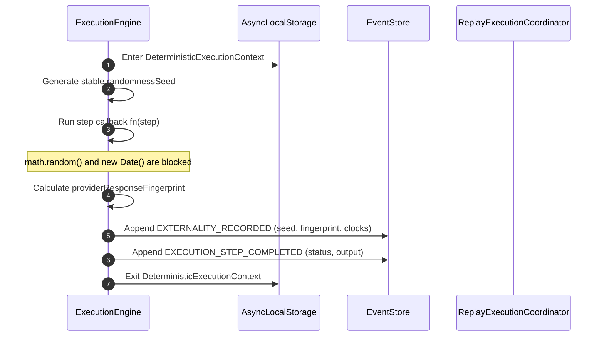

# Deterministic Boundary Specification

Correctness-critical execution in an AI Platform runtime requires absolute determinism and strict isolation of nondeterministic boundaries. This document specifies the boundary classifications, isolation architecture, persistence contracts, and execution equivalence guarantees that govern replay and recovery.

---

## 1. Nondeterminism Classification Matrix

All runtime operations are strictly partitioned into five boundary classifications. Violations of these classifications are intercepted at runtime and trigger fast-failure assertions.

| Operational Class | Description | Scope / Examples | Isolation / Enforcement Mechanism | Replay / Recovery Strategy |
| :--- | :--- | :--- | :--- | :--- |
| **Deterministic** | Pure functions, local logic, and event projections. | • State machine transitions • Fingerprint hash calculations • `deterministicId` generation | Run directly without interception. | Allowed without modification or caching. |
| **Replay-Deterministic** | Execution steps reconstructed verbatim from the event log. | • Step output playback • Monotonic sequence steps • Historical state playback | Bypasses live function execution completely; returns replayed payload from `EXTERNALITY_RECORDED` event. | Replayed verbatim; zero cost, zero external API queries. |
| **Probabilistic** | Systems with inherent runtime variation but bounded input/output. | • LLM completions • Cognitive search scoring • Semantic pruning heuristics | Bypasses the live provider during replay. Reconstructed from replayed prompt and output hashes. | Bypasses live model call; returns persisted completion payload verbatim. |
| **Externally Nondeterministic** | Operations making network/disk I/O or external API requests. | • Third-party API calls (e.g. Stripe) • Database mutations • Tool executions | Wrapped in the **Replay Sandbox**. State-mutating tools are blocked during active replay. | Live execution only allowed on `SAFE_IDEMPOTENT` tools; all others require operator approval. |
| **Unsafe Nondeterministic** | Unsynchronized/untracked operations that silently corrupt execution history. | • Global `Math.random()` calls • Standard `new Date()` / `Date.now()` calls • Concurrent thread interleaving | **Intercept-and-Block**: Global `Math.random` and `Date` are monkey-patched inside the step execution context. | Throw immediate `InvariantViolation` (`S_UNSAFE_REPLAY` / `S_POLICY_VIOLATION`) if direct access is attempted. |

---

## 2. Global Isolation & Interception Architecture

To prevent untracked nondeterminism from silently leaking into execution history, the runtime intercepts global Date and RNG functions during step execution using `AsyncLocalStorage`.

### Dynamic Interception Hooks
* **RNG Interception**: Global `Math.random()` checks `deterministicStorage.getStore()`. If called inside a step callback (and not explicitly bypassed), it throws `S_UNSAFE_REPLAY`.
* **Date Interception**: Global `new Date()` and `Date.now()` are similarly patched. Any direct usage inside a step throws `S_UNSAFE_REPLAY`.
* **Context Delegation**: Steps are injected with a `step.clock` (supplying monotonic frozen time during replay and standard time during live execution) and `step.random()` (supplying a seeded PRNG derived from the step's persisted randomness seed). These authorized calls use `runWithUntrackedAllowed` to bypass the monkey-patch checks.
* **External Integration Bypass**: Heavy integration libraries, OpenTelemetry tracers, and provider clients (e.g. model provider completions or tool executors) are wrapped in `runWithUntrackedAllowedAsync` to bypass global interceptions during network/API calls.

---

## 3. Replay Persistence Contracts

Every completed execution step commits an `EXTERNALITY_RECORDED` event to the event store. This event serves as the durable contract for reconstructing that step during replay and recovery.

### The Replay Contract Schema
An `EXTERNALITY_RECORDED` event must carry the following immutable properties in its payload:
1. **`logicalTime`**: A monotonic sequence number identifying the step's position in the execution timeline.
2. **`randomnessSeed`**: A high-entropy seed generated deterministically at the start of the step (`deterministicId([executionId, stepSequence, "seed"])`).
3. **`providerResponseFingerprint`**: A cryptographically stable hash of the step's output (`syncFingerprint(output)`).
4. **`timestamp` & `startedAt`**: Replay-monotonic wallclock timestamps preserved from the original execution.
5. **`retryAttempt`**: Monotonically increasing attempt fence count associated with the lease.

---

## 4. Execution Equivalence Guarantees

The runtime guarantees strict prefix equivalence of all execution steps up to the divergence watermark.

### Guaranteed Axioms
1. **Clock Monotonicity**: Replaying the same execution log always yields identical frame and snapshot timestamps regardless of the current system wallclock time.
2. **Bit-Monotonic RNG**: Replaying the same step with the same persisted seed yields identical pseudo-random number sequences.
3. **Fingerprint Verification**: During replay, the original input/output fingerprints are compared against live outputs (if live verification is enabled). Any mismatch triggers `UnsafeReplayDivergenceError`.
4. **Leakage Immunity**: Live tool execution is suppressed during replay. Any attempt to invoke unsafe side-effects during equivalence checks throws `InvariantViolation`.
5. **Divergence Halting**: On any timing drift (exceeding 10s), sequence gap, or order mismatch, the coordinator immediately quarantines the execution as `RECONCILIATION_REQUIRED` and terminates further mutations.
