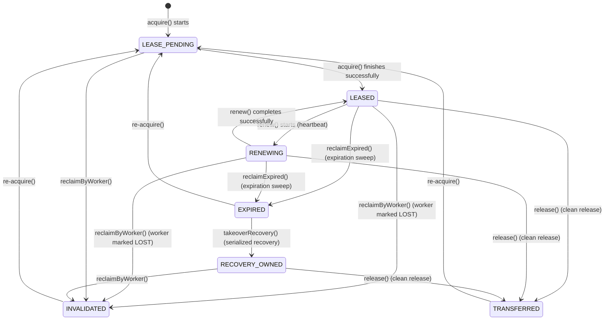
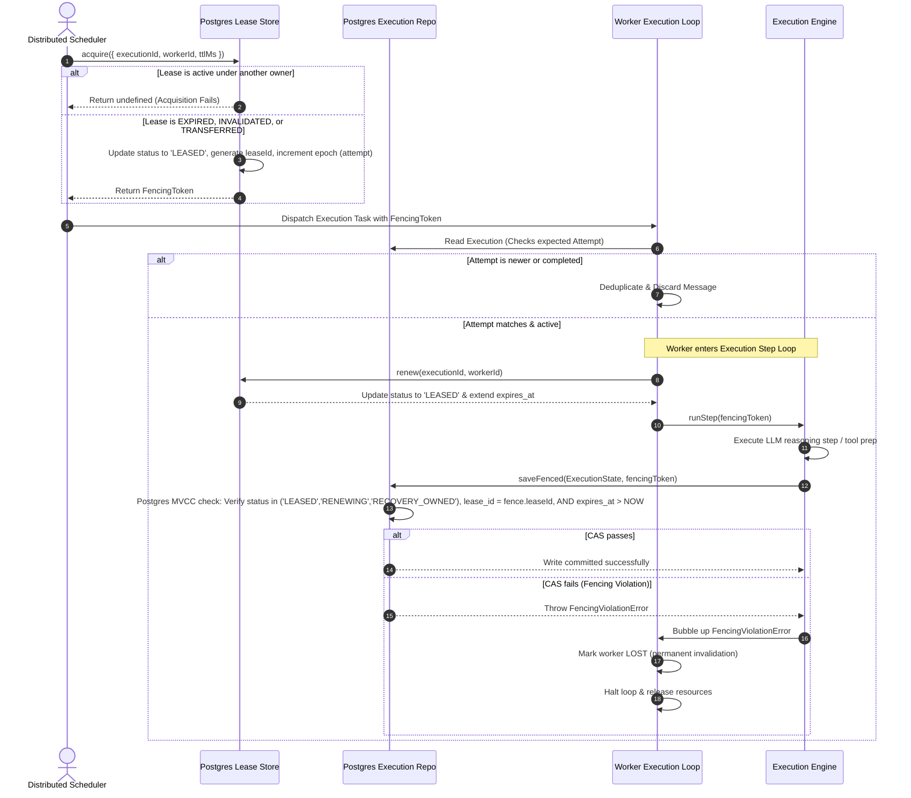

# Canonical Distributed Execution Ownership & Lease Protocol Spec

This specification documents the canonical distributed lease protocol, explicit ownership states, serialized recovery takeover, and transactional MVCC fencing validation designed to eliminate stale worker corruption, concurrent mutations, and replay collisions in the Distributed AI Runtime.

---

## 1. Redesigned Distributed Ownership States

To eliminate ambiguity and enforce strict distributed coordination, the runtime redesigns the traditional "active/inactive" advisory lease status into seven explicit, formally enforceable ownership states:

| State | Category | Description |
| :--- | :--- | :--- |
| **`LEASE_PENDING`** | Active | Acquisition process has initiated, reserving the lease slot to prevent race conditions. |
| **`LEASED`** | Active | The lease has been successfully acquired by an active worker. It holds exclusive execution rights. |
| **`RENEWING`** | Active | Heartbeat renewal is currently in-flight, updating the TTL and maintaining ownership continuity. |
| **`EXPIRED`** | Active (Sweep Candidate) | The lease expiration time (`expires_at`) has passed wall-clock time, making it a sweep candidate. |
| **`INVALIDATED`** | Inactive (Final) | The lease was reclaimed because the owning worker registry status became `LOST`. |
| **`TRANSFERRED`** | Inactive (Final) | The lease was cleanly released by the worker upon successful completion or graceful shutdown. |
| **`RECOVERY_OWNED`** | Active (Recovery) | An expired lease has been atomically taken over by a recovery worker to perform serialization sweeps. |

---

## 2. Distributed Ownership State Machine

Lease transitions are strictly validated and governed by the following lifecycle matrix:



### Invariant Transition Validation Rules

1. **Active Lease Set**: A lease is considered active iff its status is in `('LEASE_PENDING', 'LEASED', 'RENEWING', 'RECOVERY_OWNED')`.
2. **Atomic Recovery Transitions**: An expired lease (`EXPIRED`) can ONLY transition to `RECOVERY_OWNED` via the atomic CAS `takeoverRecovery()` method. This prevents duplicate recovery worker sweeps.
3. **Permanent Invalidation**: Once marked `INVALIDATED`, any further heartbeat renewal attempt by the stale worker is rejected at the Postgres level.

---

## 3. The 5-Element Canonical Fencing Token

Every execution state mutation must be validated against a **5-Element Canonical Fencing Token** to prevent stale worker writes under network partitions, GC pauses, or split-brain scenarios:

1. **`executionId`**: The globally unique identifier of the target execution context.
2. **`leaseId`**: A unique UUID generated on every fresh lease acquisition or recovery takeover, separating specific lease instances.
3. **`leaseEpoch`** (also referred to as `attempt`): A monotonically increasing integer tracking the lease acquisition counter.
4. **`workerId`**: The immutable, unique identifier of the active worker node holding the lease.
5. **`expiration`**: The UTC timestamp defining the absolute wall-clock TTL boundary.

### TypeScript Definition

```typescript
export interface FencingToken {
  readonly executionId: string;
  readonly leaseId: string;
  readonly leaseEpoch: number;
  readonly workerId: string;
  readonly expiration: string; // ISO 8601 UTC representation
}
```

---

## 4. Sequence Workflow: Distributed Execution Loop

Below is the execution flow showcasing how worker nodes coordinate with the Postgres Lease Store and Execution Repository. It illustrates lease acquisition, single-flight retry checking, fencing-token validations, and isolated replay protections.



---

## 5. Replay Ownership Isolation & Collision Protection (`RP3`)

Replay executions represent sandboxed executions of historical traces to verify correctness or reconstruct history. Because replays operate on the exact same execution model schema, concurrent execution of active runs and active replays poses a critical data corruption risk.

To enforce isolated replay pathing, the runtime implements the **`RP3` runtime invariant**:

> **Invariant `RP3`**: Isolated replay execution must not collide or be concurrently owned.

### Safety Rules Enforced for Replays

1. **Isolated Key Space**: The lease store appends `-replay` or isolates the lease context for replay executions, preventing live worker heartbeats from colliding with replay steps.
2. **Deterministic Divergence Guard**: Replays must not commit mutations to the primary execution table. They are routed to a separate, immutable snapshot database store. If a replay attempts to override a primary execution state, the Postgres CAS query rejects the write due to a mismatch of the target execution key structure.

---

## 6. Postgres Transactional MVCC & CAS Verification Proof

Every execution mutation query is guarded via atomic **Common Table Expressions (CTE)** in Postgres. This enforces that a stale worker whose lease has expired or been stolen cannot write corrupted checkpoints or status updates.

### SQL CAS Mutate Pattern (`saveFenced`)

```sql
WITH verified_fence AS (
  SELECT execution_id 
  FROM execution_leases
  WHERE execution_id = :executionId
    AND lease_id = :leaseId
    AND attempt = :leaseEpoch
    AND worker_id = :workerId
    AND status IN ('LEASED', 'RENEWING', 'RECOVERY_OWNED')
    AND expires_at > :now
)
UPDATE executions
SET 
  status = :status,
  updated_at = :now,
  state = :state
WHERE id = :executionId
  AND EXISTS (SELECT 1 FROM verified_fence);
```

### Serialized Recovery Takeover CAS (`takeoverRecovery`)

To prevent multiple recovery workers from concurrently sweeping the same expired lease and double-recovering it, the lease store provides an atomic `takeoverRecovery` method:

```sql
UPDATE execution_leases
SET
  status = 'RECOVERY_OWNED',
  worker_id = :workerId,
  acquired_at = :now,
  renewed_at = :now,
  expires_at = :expiresAt,
  attempt = attempt + 1,
  lease_id = :nextLeaseId
WHERE execution_id = :executionId
  AND status = 'EXPIRED'
RETURNING *;
```

### Mathematical Concurrency Proof

Let $W_1$ and $W_2$ be two worker processes competing for the same execution $E_x$.
Let $L(E_x)$ be the current lease record for $E_x$ in the database.

1. **Epoch & Lease ID Monotonicity**:
   Every time the lease is successfully acquired or reclaimed by a scheduler, the database updates:
   $$\text{attempt} \leftarrow \text{attempt} + 1$$
   $$\text{lease\_id} \leftarrow \text{uuid\_generate\_v4}()$$
   Thus, if $W_1$ was active during epoch $e_1$ with lease ID $id_1$, and a network partition occurs causing its lease to expire, the recovery coordinator assigns the lease to $W_2$ with epoch $e_2 = e_1 + 1$ and lease ID $id_2 \neq id_1$.

2. **The Fencing Invariant**:
   For any mutation by worker $W_i$ with token $T_i = (E_x, id_i, e_i, W_i, t_{exp})$, the Postgres CTE verifies:
   $$\text{QueryCondition} \equiv \left( L(E_x).\text{lease\_id} = id_i \wedge L(E_x).\text{attempt} = e_i \wedge L(E_x).\text{status} \in \text{\{'LEASED', 'RENEWING', 'RECOVERY\_OWNED'\}} \wedge L(E_x).\text{expires\_at} > \text{NOW} \right)$$
   
   If $W_1$ wakes up from a GC pause and attempts to commit at wall-clock time $t_{commit} > t_{exp}$:
   - **Case A**: The lease expired but has not been reclaimed.
     $$L(E_x).\text{expires\_at} < \text{NOW} \implies \text{QueryCondition} = \text{False}$$
     The update affects 0 rows, throwing a `FencingViolationError`.
     
   - **Case B**: The lease was reclaimed by $W_2$.
     $$L(E_x).\text{lease\_id} = id_2 \neq id_1 \implies \text{QueryCondition} = \text{False}$$
     The update affects 0 rows, throwing a `FencingViolationError`.

This mathematically guarantees that **at most one** worker can execute a successful write mutation at any given time.

---

## 7. Stale Worker Permanent Invalidation (Zombie Prevention)

When a worker's heartbeat fails or is swept as `LOST` by the coordinator registry, the worker is considered permanently dead. It must not be allowed to rejoin the active pool, even if its local threads recover.

### Invalidation Enforcement

1. **Heartbeat Rejection**:
   Once a worker's status is changed to `LOST` or `STOPPED` in the `runtime_workers` registry, subsequent heartbeats return `undefined` (ignored/rejected):
   ```sql
   UPDATE runtime_workers
   SET 
     last_heartbeat_at = :now,
     load = :load
   WHERE id = :workerId
     AND status NOT IN ('LOST', 'STOPPED')
   RETURNING id;
   ```
2. **Worker Self-Termination**:
   When `WorkerExecutionLoop` receives a failed heartbeat response, it immediately:
   - Sets its internal lifecycle to `TERMINATED`.
   - Rejects the in-flight tasks.
   - Refuses to pull new jobs from the queue.
   - Self-destructs the worker process.

This terminates zombie processes before they can dispatch any side-effects, keeping the cluster safe from split-brain pollution.
