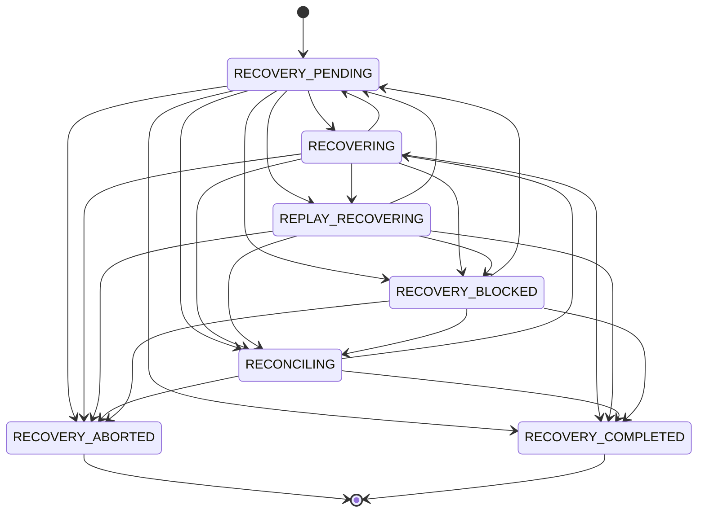
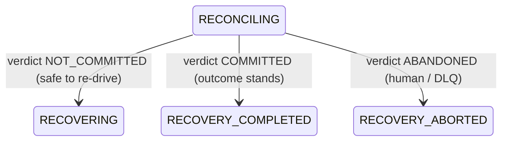

# Distributed Recovery Orchestration — Architecture

Authoritative sources:
- Lifecycle state machine — `apps/api/src/runtime/recovery/recoveryLifecycle.ts`
- Orchestrator + legality matrix — `apps/api/src/runtime/recovery/recoveryOrchestrator.ts`
- In-memory coordination store — `apps/api/src/runtime/recovery/inMemoryRecoveryStore.ts`
- Invariants — `REC1..REC9` in `apps/api/src/runtime/canonicalSemantics.ts`
- Tests — `apps/api/test/recovery/**`, `apps/api/test/chaos/recoveryOrchestrator.chaos.test.ts`

The **DistributedRecoveryOrchestrator** is the single canonical brain for recovering a
crashed, partitioned, lease-lost, or ambiguous execution. It does not re-implement the
lower correctness layers — it **composes** them into one serialized, fail-closed flow:

| Concern | Owned by | The orchestrator adds |
| --- | --- | --- |
| Ownership transfer (cross-process) | durable lease `takeoverRecovery` CAS | in-process canonical recovery state, arbitration, throttle |
| Side-effect gating | fence protocol (`fence/`) | re-drive only after fence/lease validates (REC6) |
| Replay reconstruction | replay coordinator (`replay/`) | a diverged replay recovery may never leak a live effect (REC2/REC5) |
| Ambiguity verification | reconciliation engine (`reconciliation/`) | ambiguous commit quarantined before any re-drive (REC3) |
| Retry coordination | retry coordinator (`retry/`) | recovery sits above it; RT3/RT4 still gate the re-drive |
| Dead-letter | dead-letter queue | non-recoverable / exhausted → `RECOVERY_ABORTED` escalation |

Per the coordination-authority matrix (`coordinationAuthority.ts`), the recovery
coordination record is `PROCESS` / `RECONSTRUCTABLE` — like `RETRY_COORDINATION`, it is an
in-process single-flight + canonical-state layer. **Cross-process serialization is always the
durable lease, never this record.** A total loss of the in-process record is reconstructed from
the durable lease epoch + execution state on the next sweep.

---

## Recovery lifecycle

Seven canonical states. `RECOVERY_PENDING` is the sole entry and the restartable re-entry hub;
`RECOVERY_ABORTED` and `RECOVERY_COMPLETED` are absorbing terminals. The three *strategy-executing*
states (`RECOVERING`, `REPLAY_RECOVERING`, `RECONCILING`) are **exclusive** — at most one owner epoch
may hold any of them for an execution at a time (REC1).

| State | Kind | Meaning |
| --- | --- | --- |
| `RECOVERY_PENDING` | active (entry) | recovery requested; not yet arbitrated/admitted |
| `RECOVERING` | active, exclusive | crash recovery: re-establish ownership, re-dispatch |
| `REPLAY_RECOVERING` | active, exclusive | deterministic replay reconstruction (bound by divergence rules) |
| `RECONCILING` | active, exclusive | gated behind reconciliation of an ambiguous external commit |
| `RECOVERY_BLOCKED` | active | parked: throttle/backpressure/arbitration-loss/fence-stale |
| `RECOVERY_ABORTED` | terminal | abandoned: non-recoverable / dead-letter / stale-owner / diverged give-up |
| `RECOVERY_COMPLETED` | terminal | ownership transferred & handed back, or reconciliation settled |

### State diagram

The table is validated at module load (`validateRecoveryStateMachine`): every state reachable from
`RECOVERY_PENDING`, both terminals absorbing, active ∪ terminal a clean partition, exclusivity ⊆ active.
A malformed table is a startup crash, not a runtime surprise.

### Reconciliation gate (REC3) — detail

`RECONCILING` has **no** edge to `REPLAY_RECOVERING` and no edge that re-drives without a verdict.
`resolveReconciliation` is the only legal exit. This is what makes "recovery cannot bypass
reconciliation" structural rather than advisory.

---

## Recovery legality matrix

`classifyRecovery` (pure, total) decides the strategy for a reclaimed execution. Evaluated in **strict
precedence order** so ambiguity is never silently dead-lettered and divergence is never silently
re-driven:

| # | Condition | Result | Invariant |
| --- | --- | --- | --- |
| 1 | execution already `COMPLETED` / `DEAD_LETTERED` / `CANCELLED` | `RECOVERY_COMPLETED` (no-op) | — |
| 2 | ambiguous commit (`AMBIGUOUS_EXTERNAL_COMMIT` / `TOOL_NON_IDEMPOTENT`, or status `AMBIGUOUS`/`RECONCILIATION_REQUIRED`) **and not reconciled** | `RECONCILING` | REC3 |
| 3 | replay divergence (`REPLAY_DIVERGENCE` or `replayDiverged`) | `RECONCILING` (quarantine, human-gated) | REC2, REC5 |
| 4 | attempts exhausted (`attemptCount > maxAttempts`) **or** non-recoverable failure (terminal ∧ ¬reconcilable) | `RECOVERY_ABORTED` → dead-letter | — |
| 5 | replay child (`parentExecutionId` present) | `REPLAY_RECOVERING` | — |
| 6 | otherwise | `RECOVERING` (crash recovery) | — |

Precedence rationale: rule 2 outranks rule 4 so an ambiguous-but-attempt-exhausted execution is
**reconciled, not blindly dead-lettered** — an un-reconciled external commit is the most dangerous
state to abandon. Rule 3 quarantines a divergence rather than aborting it, because `REPLAY_DIVERGENCE`
is `reconcilable + human-gated` in the recovery matrix (`RECOVERY_SEMANTICS_MAP`).

The failure → recovery-semantics mapping that rules 3/4 consult is the existing
[recovery-matrix.md](recovery-matrix.md) (`RECOVERY_SEMANTICS_MAP`).

---

## Orchestration guarantees (REC1..REC9)

Every recovery passes through `orchestrateRecovery`, which arbitrates ownership, applies
backpressure, classifies the strategy, validates the fence, and drives the lifecycle. The
guarantees and where each is enforced:

| ID | Guarantee | Enforcement point |
| --- | --- | --- |
| REC1 | **No concurrent recovery execution** — at most one owner actively recovers an execution | single coordination record per execution + monotonic-epoch CAS; non-racy local post-condition on the ownership grant |
| REC2 | **No unsafe recovery replay** — a diverged replay recovery cannot run a non-replay-safe side effect | `assertReplayRecoverySafe` (consults `isReplaySafeTool`) |
| REC3 | **No reconciliation bypass** — ambiguity → `RECONCILING` before any re-drive/completion | classification rule 2 + `RECONCILING` having no re-drive edge except via `resolveReconciliation` |
| REC4 | **Stale recovery ownership invalidated** — an epoch below the live owner surrenders | arbitration (`ALREADY_OWNED`) + store CAS `STALE_OWNER` (monotonic) |
| REC5 | **No replay/recovery divergence leakage** — a diverged replay never reaches `RECOVERY_COMPLETED` | `completeRecovery` asserts `¬(REPLAY_RECOVERING ∧ replayDiverged)`; classification quarantines divergence to `RECONCILING` |
| REC6 | **Recovery cannot bypass fencing** — ownership/re-drive only after the durable fence validates | `validateFence` gate before any strategy-executing transition; durable `takeoverRecovery` + `saveFenced` at the scheduler |
| REC7 | **Recovery backpressure bounded** — concurrent in-flight recoveries ≤ ceiling | synchronous slot reserve (no `await` between check & increment) + per-exec/global storm windows; hard breach asserts |
| REC8 | **Arbitration single-winner** — monotonic recovery epoch; ties impossible, highest wins | positive-integer epoch check + `arbitrateRecovery` (WIN/TAKEOVER/LOSE) + same-epoch-different-worker → corruption assert |
| REC9 | **Only legal lifecycle transitions admitted** | `assertRecoveryTransition` is the sole chokepoint (in-memory and durable) |

### Arbitration (REC8)

`arbitrateRecovery(existing, candidateEpoch)`:

- `WIN` — no active owner (or terminal) → claim.
- `TAKEOVER` — `candidateEpoch > owner.epoch` → legitimate failover; seize ownership.
- `LOSE` — `candidateEpoch <= owner.epoch` → zombie/duplicate; surrender.

The durable lease epoch is strictly monotonic per execution (the lease store mints it), so two
workers can never legitimately hold the same epoch. A same-epoch-different-worker observation is
treated as corruption and asserts REC8.

### Backpressure & storm (REC7)

- **Throttle** — `maxConcurrentRecoveries` (default 8). The ceiling check and the slot reserve are one
  synchronous critical section, so a burst cannot slip the gate. Exhaustion → `RECOVERY_BLOCKED`.
- **Storm windows** — per-execution + global sliding windows. Soft breach sheds to `RECOVERY_BLOCKED`;
  hard breach asserts REC7 (an amplification bug, fail-closed).

### Prioritization

`recoveryPriority` / `orderByRecoveryPriority` order a reclaimed batch (highest first):
ambiguous / human-gated failures rank top (most dangerous to leave dangling), older waits rank up
(anti-starvation), executions near the poison-pill ceiling rank down (likely poison). Pure &
deterministic so a distributed sweep orders identical batches identically.

---

## Scheduler integration

`DistributedScheduler.recoverOne` composes the layers in order:

1. **Retry-coordination gate** (`RetryCoordinator.requestRecovery`) — RT3/RT4 throttle + replay-overlap.
2. **Orchestration** (`orchestrateRecovery`) — classify, arbitrate, backpressure, drive lifecycle.
3. **Re-drive** — only on `RECOVER`/`REPLAY_RECOVER`: durable `takeoverRecovery` (cross-process single
   winner) → `saveFenced` RECOVERING (REC6 at the durable layer) → re-enqueue → `completeRecovery`.

`RECONCILE` / `ABORTED` / `BLOCKED` / `ALREADY_OWNED` / `COMPLETED` are deliberately **not** blindly
re-driven — that is the REC3 reconciliation-bypass and REC4 stale-ownership guard expressed at the
scheduler boundary.

---

## Chaos coverage

`apps/api/test/chaos/recoveryOrchestrator.chaos.test.ts` (in-memory, always runs):

| Scenario | Asserts |
| --- | --- |
| R.1 distributed crash recovery | clean `RECOVER → RECOVERY_COMPLETED`, slot freed |
| R.2 recovery after partition | fresh epoch wins; stale partitioned worker `ALREADY_OWNED` (REC4) |
| R.3 replay recovery divergence | diverged replay cannot complete (REC5); divergence routes to `RECONCILE` |
| R.4 concurrent takeover attempts | single elected owner repels every stale challenger; failover advances (REC1/REC8) |
| R.5 recovery retry storms | amplification bounded; hard breach fails closed (REC7) |
| R.6 ambiguity escalation | ambiguous commit never re-driven without reconciliation; COMMITTED settles with no double-fire (REC3) |
