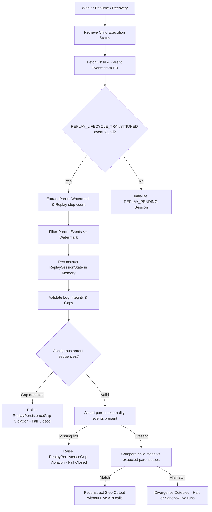
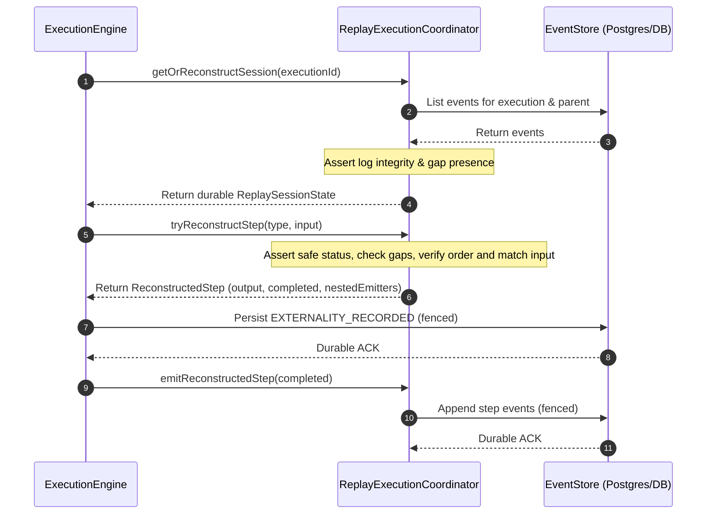

# Spec: Replay Externality Recording & Durability Architecture

This specification defines the canonical models, persistence boundaries, ordering guarantees, and reconstruction dependency systems for the correctness-critical AI Replay Runtime.

---

## 1. Canonical Externality Recording Model

Replay execution must reconstruct exact execution paths from persisted external behavior rather than non-deterministic live computation. To achieve this, the runtime captures all execution externalities at the boundary and writes them to the event store via `EXTERNALITY_RECORDED` domain events before completing any step or committing any dependent transitions.

### ReplayExternalityRecord Structure

```typescript
export interface ReplayExternalityRecord {
  id: string;                      // Unique UUID for the externality trace
  executionId: string;             // Active child execution identifier
  stepSequence: number;            // Monotonic step sequence key
  type: string;                    // PLANNING | MEMORY_RETRIEVAL | TOOL_CALL | MODEL_GENERATION | RETRY
  timestamp: string;               // ISO 8601 UTC timestamp of execution

  // Tool details (for TOOL_CALL)
  toolName?: string;               // Name of the tool executed
  toolInput?: Record<string, any>; // Exact arguments supplied
  toolOutput?: Record<string, any>;// Outcome returned by the tool
  sideEffectMetadata?: {           // Fencing and tracking info
    idempotencyKey: string;
    status: "COMPLETED" | "FAILED";
    durationMs?: number;
  };

  // LLM details (for MODEL_GENERATION)
  prompt?: string;                 // Exact serialized LLM prompt
  llmOutput?: Record<string, any>; // Extracted tool calls or generation
  providerResponse?: {             // Raw model provider response
    tokenUsage: TokenUsage;
    output: Record<string, any>;
  };

  // Randomness and Execution metadata
  randomnessSeed?: string;         // Deterministic seed generated for step
  retryAttempt?: number;           // Current lease attempt / retry count
  retryMetadata?: Record<string, any>;
  replayMetadata?: {               // Traceability metadata back to parent
    replayedFromExecutionId: string;
    originalExternalityId: string;
  };
}
```

---

## 2. Replay Persistence Matrix

The following matrix defines the mandatory boundaries, safety enforcement actions, and recovery actions per execution step type:

| Boundary / Step Type | Mandatory Persisted State | Timing of Persistence | Safety Isolation Action | Failure Recovery Action |
| :--- | :--- | :--- | :--- | :--- |
| **PLANNING** | Input task, objectives, output plan. | Before PLANNING checkpoint writes. | Checked against parent task hash. | Diversion or retry. |
| **MEMORY_RETRIEVAL** | Search query, list of memory records with retrieval scores. | Post-search completion, BEFORE `MEMORY_RETRIEVED` is emitted. | Read-only scoped; does not mutate episodic memory. | Replay equivalent retrieval. |
| **TOOL_CALL** | ToolName, toolInput arguments, toolOutput outcome, idempotency key. | Post-tool completion, ATOMICALLY within the `commitTransition` back to `RUNNING` (with `TOOL_CALLED`). | Unsafe tools blocked live (RP1); safe tools sandboxed. | Deduplication / Verification and Reconciliation. |
| **MODEL_GENERATION** | Input prompt, model config, output token usage, raw provider response. | Post-completion, BEFORE `MODEL_COMPLETED` is emitted. | Mocked in replay equivalence (CAP3); live blocked. | Hydration from logged events. |
| **RETRY / FAULT** | Non-monotonic attempt index, failure category, stack trace. | Transactional terminal fails. | Monotonicity checks (`L1`, `R1`); non-idempotent blocked. | DLQ Escalation / Operator Quarantine. |

---

## 3. Ordering Guarantees

To ensure execution ordering is 100% reproducible and safe from races:
1. **Pre-Dependent Durability**: All replay-critical externalities (`EXTERNALITY_RECORDED` events) are guaranteed to be persisted *before* or *atomically with* their corresponding dependent transitions (such as `MODEL_COMPLETED`, `MEMORY_RETRIEVED`, `TOOL_CALLED`, or `EXECUTION_STEP_COMPLETED` events).
2. **Atomic Tool Transactions**: In `runToolStep`, the `EXTERNALITY_RECORDED` event and `TOOL_CALLED` event are committed inside the *same* `commitTransition` call. This completely eliminates any possibility of partial persistence or ordering gaps where a tool executes but its externality record is missing.
3. **Monotonic Event Sequences**: All events within a given execution scope receive a contiguous, monotonic sequence index. Gaps are treated as corruption.
4. **Causal Fencing Protocol**: A state transition (e.g. `SIDE_EFFECT_PENDING -> RUNNING` or `RUNNING -> COMPLETED`) cannot be committed until all parent steps and step externalities are durably appended to the event store.
5. **Outbox FIFO Serialization**: Event dispatches to the message bus are serialized chronologically. Replay reconstructions depend only on the append-only event store and never on ephemeral dispatch interleaving.
6. **Lease Fencing Monotonicity**: Concurrency is mediated by positive, strictly increasing lease attempts. If a concurrent writer attempts to insert a step after its lease was revoked, the conditional database transaction rejects the write, and the writer surrenders.

---

## 4. Reconstruction Dependency Diagrams

Replay reconstruction relies strictly on event-sourced replay sessions, eliminating any dependency on ephemeral process memory.



### Dynamic Step Equivalent Execution


