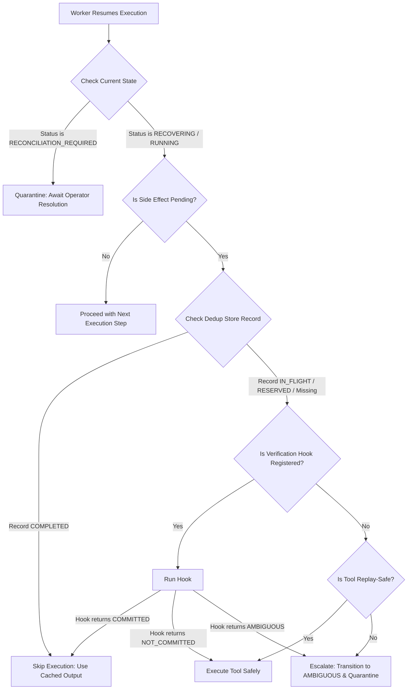

# Failure Semantics Specification

This specification formalizes the failure semantics, recovery classifications, and safety boundaries for the Distributed AI Correctness Runtime.

---

## 1. Canonical Failure Taxonomy

Every execution-scoped failure within the runtime is typed into a canonical classification to drive automation, alerting, and manual triage. Free-form error messages are retained for human debugging, but stable machine-readable taxonomy categories drive all recovery actions.

| Failure Category | Stable Code | Primary Source | Description |
| :--- | :--- | :--- | :--- |
| **PROCESS_CRASH** | `PROCESS_CRASH` | Infrastructure | Active worker thread terminates abruptly mid-execution (SIGKILL, Out-Of-Memory, node eviction). |
| **PARTIAL_COMMIT** | `PARTIAL_COMMIT` | Database / Network | Postgres transaction fails or connection drops while committing terminal execution state or outbox events. |
| **PROVIDER_TIMEOUT** | `PROVIDER_TIMEOUT` | LLM Provider | Model completing requests hang or take longer than the strict SLA threshold. |
| **LEASE_EXPIRY** | `LEASE_EXPIRY` | Scheduler / Lease | Worker heartbeat lapses, letting the lease expire naturally to be reclaimed by recovery loops. |
| **STALE_WORKER_MUTATION** | `STALE_WORKER_MUTATION` | Engine Fencing | A worker whose lease was already reclaimed by a sibling attempts to write to the execution state. |
| **REPLAY_DIVERGENCE** | `REPLAY_DIVERGENCE` | Replay Engine | Execution re-runs from parents but produces a fingerprint mismatch or input args drift at a step. |
| **NETWORK_PARTITION** | `NETWORK_PARTITION` | Transport / IO | Worker loses contact with Redis queue, Postgres persistence, or external model providers. |
| **DUPLICATE_DELIVERY** | `DUPLICATE_DELIVERY` | Redis Job Queue | A message is delivered more than once or another worker attempts execution under an active lease. |
| **AMBIGUOUS_EXTERNAL_COMMIT** | `AMBIGUOUS_EXTERNAL_COMMIT` | External Side-Effect | Process crash or timeout occurs during/immediately after an external payment, write, or mutation, leaving completion state unknown. |
| **OUTBOX_FAILURE** | `OUTBOX_FAILURE` | Event Stream | Outbox dispatcher fails to publish durably to the Kafka/Redis event streams, creating trace gaps. |

---

## 2. Explicit Recovery Semantics

Each failure type maps to a strict set of recovery behaviors. These properties determine whether the runtime should perform automatic recovery (auto-retries, automatic re-acquire, automatic replay) or quarantine execution.

*   **Retryable**: The execution can be safely retried at the queue level with exponential backoff.
*   **Replayable**: The execution prefix is deterministic and can be safely re-run from checkpoints.
*   **Reconcilable**: The failure involves potential external side effects or state mismatches that require running verification hooks to align external and internal state.
*   **Terminal**: The current execution path is dead and must surrender immediately.
*   **Requires Human Intervention**: The execution is quarantined in a special state, suspending progress until resolved by an operator.

### Recovery Semantics Mapping

| Failure Type | Retryable | Replayable | Reconcilable | Terminal | Human Intervention |
| :--- | :---: | :---: | :---: | :---: | :---: |
| `PROCESS_CRASH` | **Yes** | **Yes** | **Yes** | No | No |
| `PARTIAL_COMMIT` | **Yes** | No | **Yes** | No | No |
| `PROVIDER_TIMEOUT` | **Yes** | **Yes** | No | No | No |
| `LEASE_EXPIRY` | **Yes** | **Yes** | No | No | No |
| `STALE_WORKER_MUTATION` | No | No | No | **Yes** | No |
| `REPLAY_DIVERGENCE` | No | No | **Yes** | **Yes** | **Yes** |
| `NETWORK_PARTITION` | **Yes** | **Yes** | No | No | No |
| `DUPLICATE_DELIVERY` | No | **Yes** | No | No | No |
| `AMBIGUOUS_EXTERNAL_COMMIT` | No | No | **Yes** | No | **Yes** |
| `OUTBOX_FAILURE` | **Yes** | **Yes** | **Yes** | No | No |

---

## 3. Recovery Decision Tables

When a recovery tick occurs, or a worker resumes execution, it uses the following decision logic to determine the recovery path:

### Execution Decision Matrix

| Active Status | Dedup Status | Hook Availability | Tool Classification | Action Taken |
| :--- | :--- | :--- | :--- | :--- |
| `RECOVERING` | `COMPLETED` | Irrelevant | Irrelevant | **Bypass Execution**: Fetch cached result, emit `TOOL_CALLED` event. |
| `RECOVERING` | `IN_FLIGHT` | Registered | Irrelevant | **Invoke Hook**: If hook resolves to `COMMITTED`, bypass tool and proceed; if `NOT_COMMITTED`, execute; if `AMBIGUOUS`, escalate. |
| `RECOVERING` | `IN_FLIGHT` | None | Safe (e.g. search) | **Safe Execute**: Re-run the tool safely (idempotent / side-effect-free). |
| `RECOVERING` | `IN_FLIGHT` | None | Unsafe (e.g. payment) | **Escalate**: Transition to `AMBIGUOUS` -> `RECONCILIATION_REQUIRED`, throw `AmbiguityDetectedError`, and quarantine. |
| `REPLAYING` | `DIVERGED` | Irrelevant | Unsafe | **Sandbox Violation**: Assert `RP1` invariant, throw `ReplaySandboxViolationError`, block execution. |
