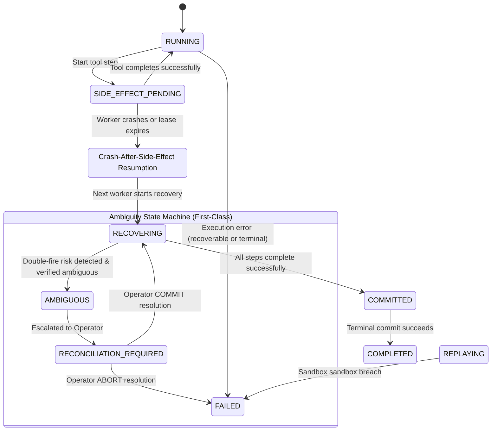
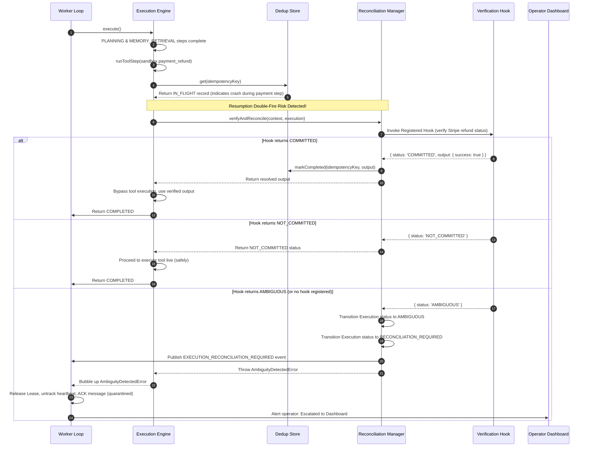

# Reconciliation Architecture & Ambiguity Lifecycle Specification

This specification documents the first-class ambiguity architecture, state transitions, event schemas, and escalation paths designed to eliminate undefined recovery states in the Distributed AI Correctness Runtime.

---

## 1. Ambiguity Lifecycle Diagrams

Ambiguity is introduced as a first-class state inside the runtime lifecycle rather than being treated as a side effect or hidden error.

### state transition lifecycle:



---

## 2. Sequence Workflow: Verification & Reconciliation

When resuming a `SIDE_EFFECT_PENDING` checkpoint or state, the execution engine triggers a verification check to protect against duplicate side effects:



---

## 3. Operator Escalation Interfaces

The operator escalation path provides structured mechanisms to safely override and resolve wedged executions.

### 3.1 Event Schema: `EXECUTION_RECONCILIATION_REQUIRED`
This event is published to alerting and operational dashboards when a side effect enters the quarantined state:

```json
{
  "eventId": "evt_9981273948",
  "eventType": "EXECUTION_RECONCILIATION_REQUIRED",
  "aggregateId": "exec-failure",
  "aggregateType": "EXECUTION",
  "timestamp": "2026-05-28T01:42:00.000Z",
  "payload": {
    "executionId": "exec-failure",
    "toolName": "sandbox.payment_refund",
    "idempotencyKey": "9f27c8a98b0c48e89f2a870d0b0d39e1",
    "stepSequence": 3,
    "args": {
      "amount": 1200,
      "currency": "usd",
      "userId": "user_8829"
    },
    "message": "[invariant:S3] ambiguous execution state: double-fire risk for side effect 'sandbox.payment_refund' with key '9f27c8a98b0c48e89f2a870d0b0d39e1'"
  },
  "metadata": {
    "traceId": "tr_11002349",
    "tenantId": "tenant-failure"
  }
}
```

### 3.2 Reconciliation Overrides

Operators resolve stuck executions through two explicit, transactionally-safe operations:

#### 1. Confirm Commit (`COMMIT` override)
Used when the operator verifies externally (e.g. checking Stripe logs) that the side effect did execute.
*   **Action**: Operator hits **"Confirm Succeeded"** and provides the actual transaction ID or response.
*   **Underlying Transition**:
    *   Injects the response into `tool_call_dedup` cache.
    *   Transition execution status from `RECONCILIATION_REQUIRED` -> `RECOVERING`.
    *   Publishes `EXECUTION_RECONCILIATION_RESOLVED` event.
    *   The worker retrieves the job on the next recovery tick, hits `RETURN_CACHED`, bypasses the tool execution, and proceeds successfully.

#### 2. Confirm Abort (`ABORT` override)
Used when the operator decides it is unsafe to proceed or the transaction was cancelled.
*   **Action**: Operator hits **"Force Fail Execution"**.
*   **Underlying Transition**:
    *   Transitions execution status from `RECONCILIATION_REQUIRED` -> `FAILED`.
    *   Durably writes the manual cancellation failure message.
    *   Publishes `EXECUTION_RECONCILIATION_RESOLVED` event.
    *   Leases are closed and execution ends in terminal failed state.
