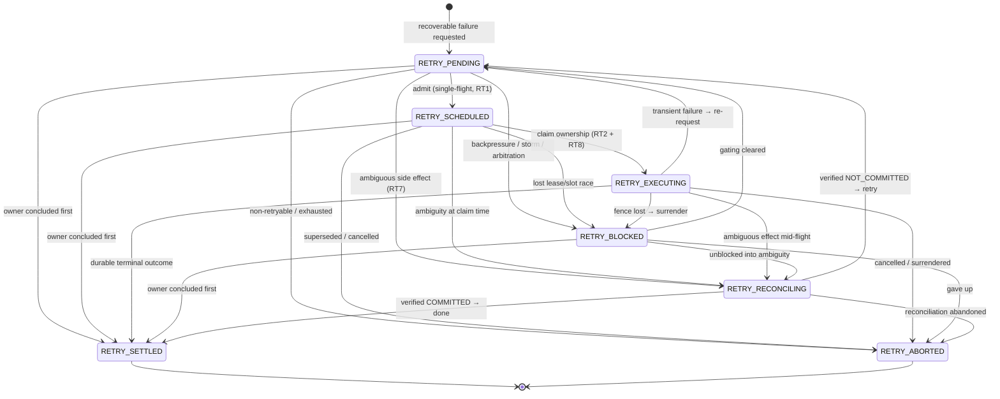
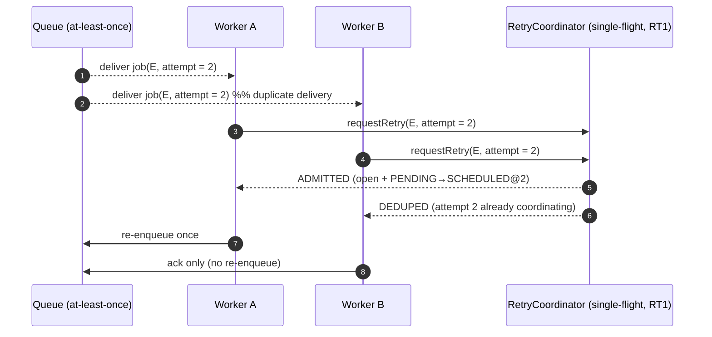
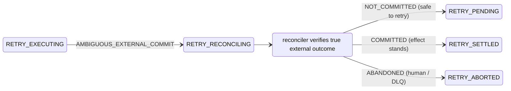
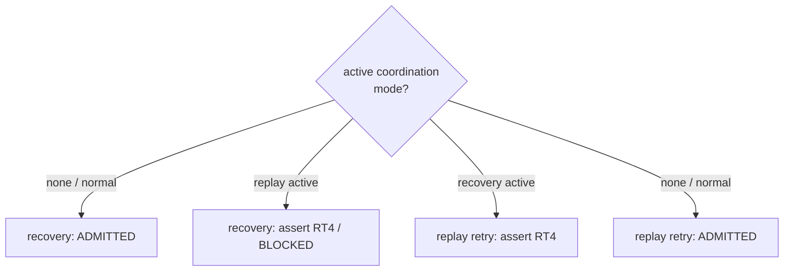

# Recovery Serialization & Retry-Coordination Diagrams

Visual companion to [retry-coordination.md](./retry-coordination.md). Every
diagram below is a direct projection of the code in
`apps/api/src/runtime/retry/` and its wiring in
`apps/api/src/application/cluster/`.

---

## 1. Retry coordination state machine

Source: `RETRY_TRANSITION_TUPLES` in `apps/api/src/runtime/retry/retryState.ts`
(structurally validated at module load by `validateRetryStateMachine`).



`RETRY_SETTLED` and `RETRY_ABORTED` are absorbing. A concluded coordination
re-enters the active set only via `store.open` (create-or-reset), which refuses
to disturb a *live* coordination — this is the single-flight gate (RT1).

---

## 2. Serialized recovery takeover (concurrent recoverers race one expired lease)

Source: `DistributedScheduler.recoverOne` → `requestRecovery` →
`LeaseStore.takeoverRecovery`. The durable CAS picks one cross-process winner;
the coordinator throttles and blocks replay overlap.

```mermaid
sequenceDiagram
    autonumber
    participant R1 as Recovery sweep #1
    participant R2 as Recovery sweep #2
    participant C as RetryCoordinator (throttle + RT3/RT4)
    participant L as Lease store (durable CAS)

    Note over R1,R2: lease for E expired (attempt = N); both sweeps reclaim it

    R1->>C: requestRecovery(E, ownerEpoch = N+1)
    R2->>C: requestRecovery(E, ownerEpoch = N+1)
    C-->>R1: ADMITTED (reserve recovery slot)
    C-->>R2: ALREADY_OWNED  (recovery already owns ≥ epoch) — skip

    R1->>L: takeoverRecovery(E)  [EXPIRED → RECOVERY_OWNED, attempt = N+1]
    L-->>R1: recoveryLease(attempt = N+1)
    R1->>R1: execution → RECOVERING, re-enqueue onto shared queue
    R1->>C: release() recovery slot

    Note over R2: never reached takeoverRecovery — serialized at the coordinator
```

If the coordinator had admitted both (e.g. distinct epochs racing), the durable
`takeoverRecovery` CAS still yields exactly one winner — the second sees state
≠ `EXPIRED` and returns `undefined`, and its slot is released in `finally`.

---

## 3. Single-flight under a queue-redelivery / duplicate-scheduler storm

Source: `RetryCoordinator.requestRetry`. N concurrent deliveries of one logical
attempt collapse to one admission.



---

## 4. Ambiguity quarantine — retries cannot bypass reconciliation (RT7)



While in `RETRY_RECONCILING`, `requestRetry` returns `RECONCILE_REQUIRED` for any
newer attempt and `claimExecution` returns `RECONCILE_REQUIRED` — no re-dispatch
is possible until `resolveReconciliation` leaves the state.

---

## 5. Replay / recovery mutual exclusion (RT4)



`requestRecovery` over an active replay coordination, and a `mode: replay`
`requestRetry` over an active recovery coordination, both trip
`assertNoReplayRecoveryOverlap` (RT4). Replay child executions additionally have
an isolated lease key space (`RP3`), so live and replay ownership never share a
lease row.

---

## 6. End-to-end worker loop with coordination gates

Source: `WorkerExecutionLoop.executeJobInner`.

```mermaid
sequenceDiagram
    autonumber
    participant Q as Job queue
    participant W as Worker loop
    participant L as Lease store
    participant C as RetryCoordinator
    participant E as Execution engine

    Q-->>W: deliver job(E, attempt = a)
    W->>L: acquire(E)  →  lease(epoch = k)
    W->>C: claimExecution(E, ownerEpoch = k, validateFence)
    alt not OWNED (stale / fenced / reconciling)
        C-->>W: STALE | FENCED | RECONCILE_REQUIRED
        W->>Q: ack (surrender, no re-deliver) + release lease
    else OWNED
        C-->>W: OWNED  (RETRY_EXECUTING@k)
        W->>E: execute(...)
        alt success
            W->>C: settle(E)  →  RETRY_SETTLED
            W->>Q: ack
        else ambiguous effect
            W->>C: enterReconciliation(E)  →  RETRY_RECONCILING
            W->>Q: ack (quarantine)
        else fence-lost
            W->>Q: ack (winner owns it; leave coordination)
        else transient error
            W->>C: requestRetry(E, attempt = a+1)
            alt ADMITTED / BLOCKED
                W->>Q: re-enqueue (BLOCKED uses extended backoff)
            else DEDUPED / RECONCILE_REQUIRED
                W->>Q: ack (no re-enqueue)
            else ABORTED
                W->>Q: dead-letter
            end
        end
    end
```
