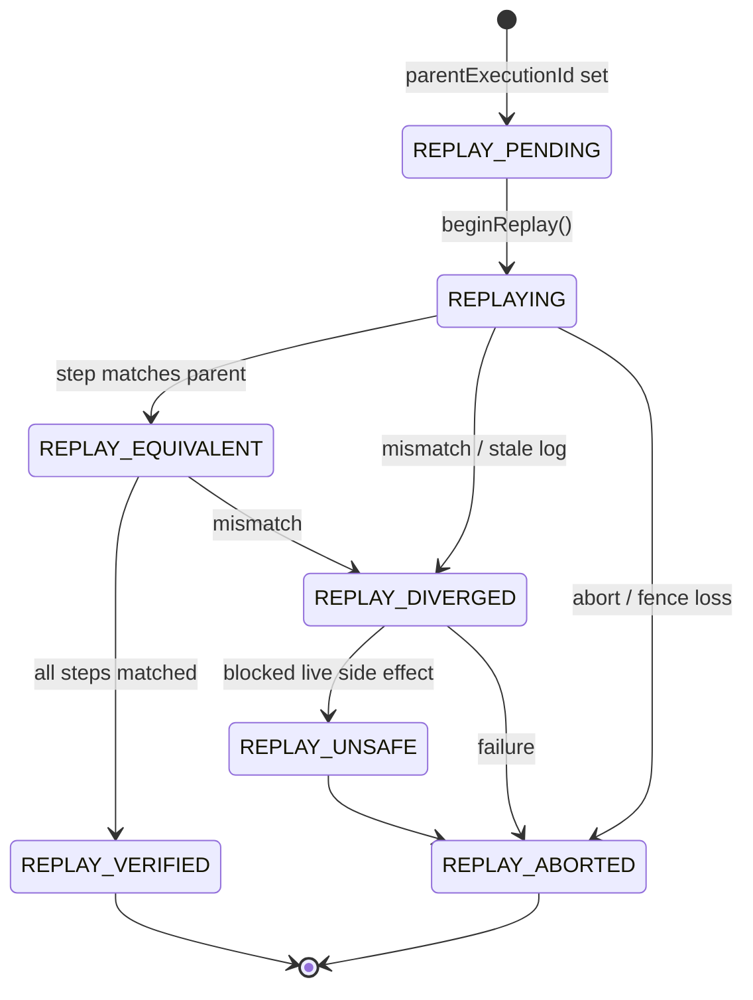
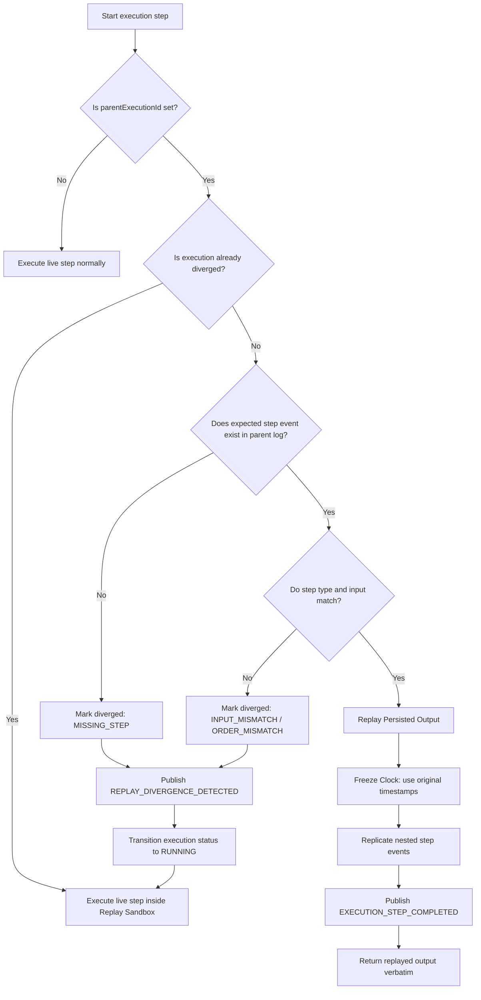
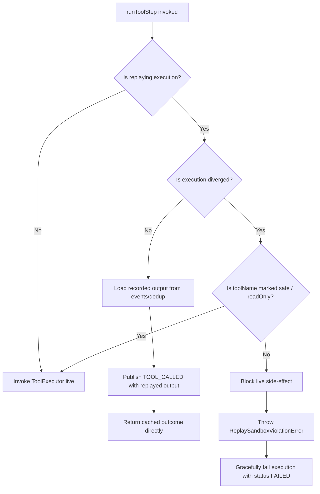

# Replay Lifecycle Diagrams

This document contains Mermaid diagrams illustrating the step-by-step decision logic, safety checks, and state transitions of the replay-equivalent execution engine and sandbox isolation.

---

## 0. Replay Lifecycle State Machine

---

## 1. Replay Interception and Divergence Logic

The following diagram outlines the decision flow inside `runStep` and `runToolStep` when an execution carries a `parentExecutionId`.

---

## 2. Replay Sandbox Isolation Decision Tree

The following diagram traces how tool executions are gated inside `runToolStep` for a replaying execution.

